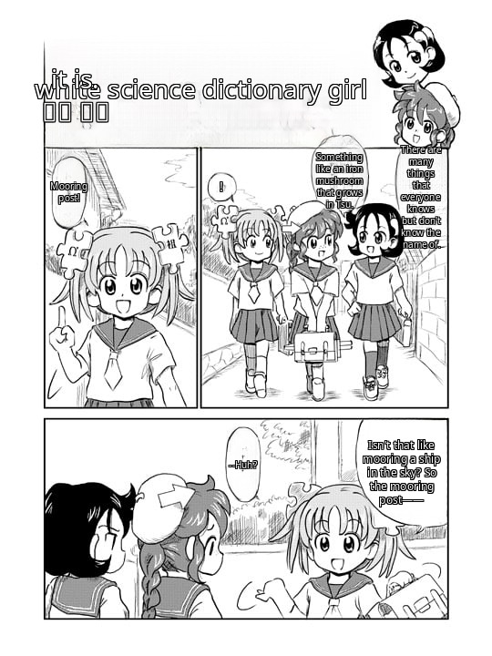
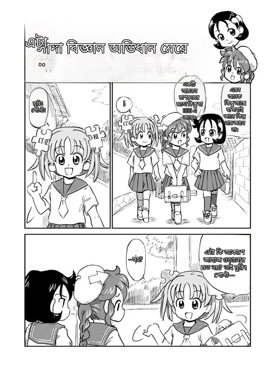
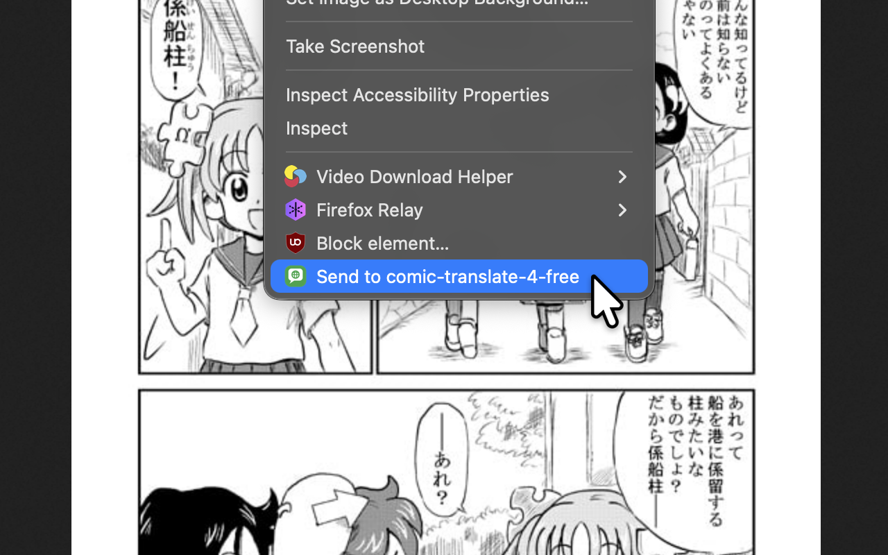

# Comic Translate 4 Free

Language: [English](README.md) · [हिन्दी](README/README.hi.md) · [日本語](README/README.ja.md) · [한국어](README/README.ko.md) · [简体中文](README/README.zh-CN.md) · [繁體中文](README/README.zh-TW.md) · [Español](README/README.es.md) · [العربية](README/README.ar.md) · [Français](README/README.fr.md) · [বাংলা](README/README.bn.md) · [Português](README/README.pt.md) · [Русский](README/README.ru.md) · [Tiếng Việt](README/README.vi.md) · [Bahasa Indonesia](README/README.id.md) · [اردو](README/README.ur.md) · [Deutsch](README/README.de.md) · [Română](README/README.ro.md)

Read manga in your language — right in the browser.

Comic Translate 4 Free translates manga and comic pages automatically as you browse. It reads Japanese, English, Simplified and Traditional Chinese (with auto-detect), and translates into 114 languages. Open a page, and the translated version replaces the original image in place — speech bubbles filled with your language.

### 📸 Before & After

| Before (Japanese) | After (English) |
| --- | --- |
|  |  |

See translations in 14 more languages

| Hindi | Korean | Simplified Chinese |
| --- | --- | --- |
|  |  |  |

| Traditional Chinese | Spanish | Arabic |
| --- | --- | --- |
|  |  |  |

| French | Bengali | Portuguese |
| --- | --- | --- |
|  |  |  |

| Russian | Vietnamese | Indonesian |
| --- | --- | --- |
|  |  |  |

| Urdu | German |
| --- | --- |
|  |  |

*Original Wikipe-tan illustration by Kasuga, from [Wikipedia's Manga article](https://en.wikipedia.org/wiki/Manga) via Wikimedia Commons — licensed under [CC BY-SA 3.0](https://creativecommons.org/licenses/by-sa/3.0/). The translated screenshots are modified derivatives of the original.*

---

## ✨ Features

- Automatic translation (Pro) — open a manga page on an allowed site and the translated version appears in place, no button click needed. Free for 50 images a day; unlimited with Pro.
- Every picture on the page — auto-translate handles all pictures on a page (up to 50 per run), not just the main image.
- Pre-translate the next page (Pro) — while you read the current page, the next page's picture is translated in the background, so it is ready the moment you open it (one picture only; on by default, turn it off in Settings). Free for 50 images a day; unlimited with Pro.
- Engine failover — if the selected translation engine fails, the extension automatically tries another one. Free, always on.
- Right-click any image — choose "Send to Comic Translate 4 Free" to translate a specific picture, even one smaller than the minimum size.
- 114 target languages via Google Translator, Gemini, Azure Translator, or your own local LM Studio server.
- Source language auto-detect — Japanese, English, Simplified/Traditional Chinese identified automatically from the OCR'd text.
- Long-strip / webtoon support — tall pages are processed in overlapping segments so text stays sharp.
- 17 UI languages — the extension interface follows your browser's language setting.
- Target language defaults to your browser's language — change it anytime in Settings.

### 🔒 Privacy

- The AI runs on your machine. Bubble detection, OCR, and inpainting all run locally in your browser. Detection and OCR run via WebAssembly. Inpainting runs on GPU on Chrome (with WebAssembly fallback), and via WebAssembly on Firefox. Your pages never leave your device.
- Only translated text is sent out — just the extracted strings go to the translation service you choose (Google / Gemini / Azure / your local LM Studio).
- No account, no tracking, no telemetry. All settings and cached models stay in your browser's local storage.

---

## 🚀 Installation

Chrome / Edge / Brave:

[Install from the Chrome Web Store](https://chromewebstore.google.com/detail/pndooikgcenncdohfggodonniihplppj) — one click, automatic updates.

Firefox:

[Install from Firefox Add-ons](https://addons.mozilla.org/en-US/firefox/addon/comic-translate-4-free/) — one click, automatic updates.

After installing, the models download automatically in the background (~350 MB: detector, OCR, inpainter). They're cached in the browser and verified by byte size. If a translation starts before they finish, it waits for them.

---

## 💡 How to Use

1. Allow the site first — click the extension icon and press Allow this site (or enable ALLOW ALL SITES). Translation only runs where you've granted permission.

   

2. Reload the manga page — it starts translating automatically when the page loads. A pill in the top-right shows live progress (Capturing → Detecting → OCR → …).
3. Done — the page's pictures are replaced in place with the translated versions.

Tips:
- Right-click any image → Send to Comic Translate 4 Free to translate just that picture.

  

- If a site blocks downloads (HTTP 403), the extension automatically retries via a background tab.
- Pick your translation engine in Settings: Google Translator (no key), Gemini (key required, recommended — better manga translation), Azure Translator (being retired), or LM Studio (local server).

---

## 🔑 Get a Gemini API key

Gemini gives the best manga translations. To use it as the translation engine:

1. Open [Google AI Studio](https://aistudio.google.com/apikey) and click "Create API key"
2. Pick or create a Google Cloud project if asked
3. Copy the key
4. Paste it into the Gemini API key field in the extension's Settings, then click "Check Gemini connection"
5. Pick Gemini as the translation engine in Settings

---

## 💎 Pro

Translations count toward the free 50 images a day while any Pro feature is on. One image counts as one, whatever its height. Turn both Pro features off and translating is free and unlimited. Auto-translate and pre-translate are Pro features — free for 50 images a day, unlimited with a Pro subscription.

- $3/month or $30/year
- Buy a license key, paste it into the License key field in the extension's Settings, and click Activate Pro. The key works on 2 browsers.

---

## ⚠️ Known Issues

- No Korean OCR yet — source languages are Japanese, English, and Simplified/Traditional Chinese. (Korean remains available as a translation target.)
- Large sessions — translating dozens of images in one session can restart the extension in the background. If that happens, the run resumes automatically from where it left off.
- Firefox — models run in the background page (no offscreen documents), sharing memory with everything else. Restart the browser if you see "no available backend found".
- Firefox is slower than Chrome — Firefox extensions cannot use shared memory for multi-threading (SharedArrayBuffer), so the model runs on one CPU thread. This is a Firefox platform limit, not an extension bug ([Mozilla bug 1673477](https://bugzilla.mozilla.org/show_bug.cgi?id=1673477)).
- Google Translator uses the unofficial free endpoint and may be rate-limited.

---

## 📄 Third-party notices

This project is inspired by [ogkalu2/comic-translate](https://github.com/ogkalu2/comic-translate) — the bubble/text detector and the manga-finetuned LaMa inpainter are its ONNX exports, and the inference logic is ported from it. (OCR uses [Baberu](https://huggingface.co/genshiai-daichi/baberu-ocr) by genshiai-daichi.)

Bundled libraries, ported code, and runtime-downloaded models are listed with their licenses in [THIRD-PARTY-NOTICES.md](THIRD-PARTY-NOTICES.md).

PolyForm Noncommercial License 1.0.0 — see [LICENSE](LICENSE).
