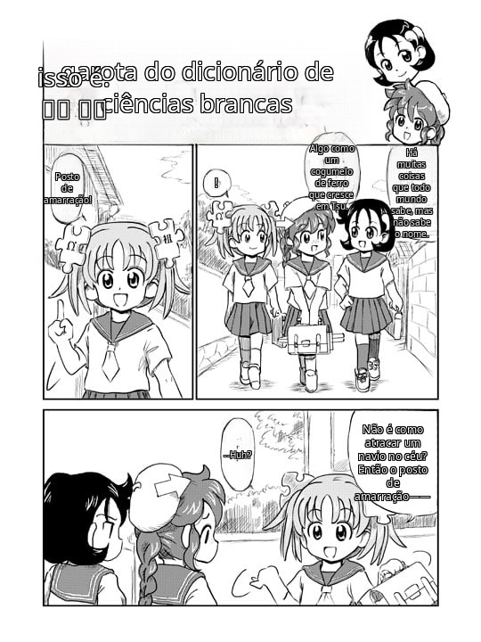
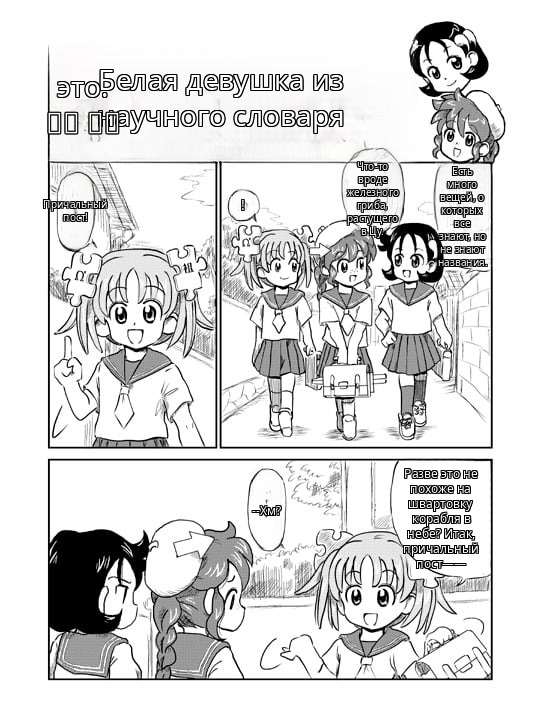

# Comic Translate 4 Free

اللغة: [English](../README.md) · [हिन्दी](README.hi.md) · [日本語](README.ja.md) · [한국어](README.ko.md) · [简体中文](README.zh-CN.md) · [繁體中文](README.zh-TW.md) · [Español](README.es.md) · [العربية](README.ar.md) · [Français](README.fr.md) · [বাংলা](README.bn.md) · [Português](README.pt.md) · [Русский](README.ru.md) · [Tiếng Việt](README.vi.md) · [Bahasa Indonesia](README.id.md) · [اردو](README.ur.md) · [Deutsch](README.de.md) · [Română](README.ro.md)

اقرأ المانغا بلغتك — في المتصفح مباشرةً.

Comic Translate 4 Free يترجم المانغا والقصص المصورة تلقائيًا أثناء التصفح. يقرأ اليابانية والإنجليزية والصينية المبسطة والتقليدية (مع الكشف التلقائي)، ويترجم إلى 114 لغة. افتح صفحة، وستحل النسخة المترجمة محل الصورة الأصلية في مكانها — فقاعات الكلام مملوءة بلغتك.

### 📸 قبل & بعد

| قبل (اليابانية) | بعد (العربية) |
| --- | --- |
|  |  |

See translations in 14 more languages

| Hindi | Korean | Simplified Chinese |
| --- | --- | --- |
|  |  |  |

| Traditional Chinese | Spanish | Arabic |
| --- | --- | --- |
|  |  |  |

| French | Bengali | Portuguese |
| --- | --- | --- |
|  |  |  |

| Russian | Vietnamese | Indonesian |
| --- | --- | --- |
|  |  |  |

| Urdu | German |
| --- | --- |
|  |  |

*رسم Wikipe-tan الأصلي بريشة Kasuga، من [مقالة المانغا في Wikipedia](https://en.wikipedia.org/wiki/Manga) عبر Wikimedia Commons — مرخّص بموجب [CC BY-SA 3.0](https://creativecommons.org/licenses/by-sa/3.0/). لقطات الشاشة المترجمة هي أعمال مشتقة معدّلة من الأصل.*

---

## ✨ الميزات

- الترجمة التلقائية (Pro) — افتح صفحة مانغا على موقع مسموح به وستظهر النسخة المترجمة في مكانها، دون الحاجة إلى النقر على أي زر. مجانية لما يصل إلى 50 صورة في اليوم؛ وغير محدودة مع Pro.
- كل صورة على الصفحة — الترجمة التلقائية تتعامل مع جميع الصور في الصفحة (حتى 50 صورة في كل تشغيل)، وليس فقط الصورة الرئيسية.
- ترجمة الصفحة التالية مسبقًا (Pro) — بينما تقرأ الصفحة الحالية، تُترجم صورة الصفحة التالية في الخلفية، فتكون جاهزة لحظة فتحها (صورة واحدة فقط؛ مفعّلة افتراضيًا، ويمكن إيقافها من الإعدادات). مجانية لما يصل إلى 50 صورة في اليوم؛ وغير محدودة مع Pro.
- تجاوز محرك الترجمة عند الفشل — إذا فشل محرك الترجمة المحدد، أو أعاد نصًا بلغة خاطئة، تحاول الإضافة تلقائيًا محركًا آخر. مجاني، ويعمل دائمًا.
- OCR (testing) — محرك OCR تجريبي سريع لصفحات اليابانية. فعّله من الإعدادات، ضمن Debug. أسرع بكثير على الهواتف.
- تبويب واحد في كل مرة — أثناء ترجمة أحد التبويبات، يكون زر "Translate" في التبويب الآخر رماديًا (معطّلًا). ويقرأ زر الإلغاء "Cancel other tab".
- انقر بزر الماوس الأيمن على أي صورة — اختر "إرسال إلى Comic Translate 4 Free" لترجمة صورة محددة، حتى لو كانت أصغر من الحد الأدنى للحجم.
- 114 لغة مستهدفة عبر Google Translator أو Gemini أو Azure Translator أو خادم LM Studio المحلي الخاص بك.
- الكشف التلقائي عن لغة المصدر — يتم تحديد اليابانية والإنجليزية والصينية المبسطة/التقليدية تلقائيًا من النص الذي يتعرف عليه OCR.
- دعم الشرائط الطويلة / الويبتون — تتم معالجة الصفحات الطويلة في مقاطع متداخلة ليبقى النص حادًا.
- 17 لغة لواجهة المستخدم — تتبع واجهة الإضافة إعداد لغة المتصفح.
- لغة الهدف الافتراضية هي لغة متصفحك — يمكنك تغييرها في أي وقت من الإعدادات.

### 🔒 الخصوصية

- يعمل الذكاء الاصطناعي على جهازك. يعمل كشف الفقاعات وOCR وإزالة النص (inpainting) محليًا في متصفحك. يعمل الكشف وOCR عبر WebAssembly. ويعمل inpainting على GPU في Chrome (مع الرجوع إلى WebAssembly)، وعبر WebAssembly في Firefox. صفحاتك لا تغادر جهازك أبدًا.
- يتم إرسال النص المترجم فقط — فقط السلاسل النصية المستخرجة تذهب إلى خدمة الترجمة التي تختارها (Google / Gemini / Azure / LM Studio المحلي).
- لا حساب، لا تتبع، لا قياس عن بُعد. تبقى جميع الإعدادات والنماذج المخزنة مؤقتًا في التخزين المحلي للمتصفح.

---

## 🚀 التثبيت

Chrome / Edge / Brave:

[ثبّت من Chrome Web Store](https://chromewebstore.google.com/detail/pndooikgcenncdohfggodonniihplppj) — بضغطة واحدة، مع تحديثات تلقائية.

Firefox:

[ثبّت من إضافات Firefox](https://addons.mozilla.org/en-US/firefox/addon/comic-translate-4-free/) — نقرة واحدة، تحديثات تلقائية.

بعد التثبيت، تُنزَّل النماذج تلقائيًا في الخلفية (~350 ميغابايت: الكاشف، OCR، أداة inpainting). يتم تخزينها مؤقتًا في المتصفح والتحقق منها حسب حجم البايت. إذا بدأت ترجمة قبل اكتمال تنزيلها، فستنتظرها.

---

## 💡 كيفية الاستخدام

1. اسمح للموقع أولًا — انقر على أيقونة الإضافة واضغط السماح لهذا الموقع (أو فعّل السماح لكل المواقع). الترجمة تعمل فقط حيث منحت الإذن.

   

2. أعد تحميل صفحة المانغا — تبدأ الترجمة تلقائيًا عند تحميل الصفحة. تظهر فقاعة في أعلى اليمين تقدمًا مباشرًا (Capturing → Detecting → OCR → …).
3. تم — يتم استبدال صور الصفحة في مكانها بالنسخ المترجمة.

نصائح:
- انقر بزر الماوس الأيمن على أي صورة ← إرسال إلى Comic Translate 4 Free لترجمة تلك الصورة فقط.

  

- إذا حظر موقع ما التنزيلات (HTTP 403)، تعيد الإضافة المحاولة تلقائيًا عبر علامة تبويب في الخلفية.
- اختر محرك الترجمة في الإعدادات: Google Translator (بدون مفتاح)، أو Gemini (يتطلب مفتاحًا، موصى به — ترجمة مانغا أفضل)، أو Azure Translator (يتم إيقافه)، أو LM Studio (خادم محلي).

---

## 🔑 الحصول على مفتاح Gemini API

يقدم Gemini أفضل ترجمات المانغا. لاستخدامه كمحرك ترجمة:

1. افتح [Google AI Studio](https://aistudio.google.com/apikey) وانقر على "Create API key"
2. اختر مشروع Google Cloud أو أنشئ مشروعًا جديدًا إذا طُلب منك ذلك
3. انسخ المفتاح
4. الصقه في حقل مفتاح Gemini API في إعدادات الإضافة، ثم انقر على "اختبار اتصال Gemini"
5. اختر Gemini كمحرك ترجمة في الإعدادات

---

## 💎 Pro

تُحسب الترجمات ضمن حد 50 صورة مجانية في اليوم أثناء تفعيل أي ميزة من ميزات Pro. تُحسب الصورة الواحدة كصورة واحدة، مهما كان ارتفاعها. أوقف ميزتي Pro وستكون الترجمة مجانية وغير محدودة. الترجمة التلقائية والترجمة المسبقة ميزتان من ميزات Pro — مجانيتان لما يصل إلى 50 صورة في اليوم، وغير محدودتين مع اشتراك Pro.

- $3 شهريًا أو $30 سنويًا
- اشترِ مفتاح ترخيص، والصقه في حقل "License key" في إعدادات الإضافة، ثم انقر على "Activate Pro". يعمل المفتاح على متصفحين.
- عند بلوغ حد 50 صورة مجانية، تظهر نافذة منبثقة للتذكير مرة واحدة في اليوم. بعد تقييم الإضافة، يصبح زر "Get Pro" ‏"Copy Discount Code: 5STARS" — انقر عليه لنسخ الرمز وفتح صفحة الدفع.

---

## ⚠️ مشكلات معروفة

- لا يوجد OCR للكورية بعد — لغات المصدر هي اليابانية والإنجليزية والصينية المبسطة/التقليدية. (تبقى الكورية متاحة كلغة ترجمة مستهدفة.)
- الجلسات الكبيرة — ترجمة عشرات الصور في جلسة واحدة قد تعيد تشغيل الإضافة في الخلفية. إذا حدث ذلك، يستأنف التشغيل تلقائيًا من حيث توقف.
- Firefox — تعمل النماذج في صفحة الخلفية (بدون مستندات offscreen)، وتتشارك الذاكرة مع كل شيء آخر. أعد تشغيل المتصفح إذا رأيت "no available backend found".
- Firefox أبطأ من Chrome — إضافات Firefox لا يمكنها استخدام الذاكرة المشتركة للمعالجة متعددة الخيوط (SharedArrayBuffer)، لذا يعمل النموذج على خيط واحد لوحدة المعالجة المركزية. هذا قيد في منصة Firefox، وليس خطأ في الإضافة ([Mozilla bug 1673477](https://bugzilla.mozilla.org/show_bug.cgi?id=1673477)).
- يستخدم Google Translator نقطة النهاية المجانية غير الرسمية وقد يكون محدود المعدل.

---

## 📄 إشعارات الطرف الثالث

هذا المشروع مستوحى من [ogkalu2/comic-translate](https://github.com/ogkalu2/comic-translate) — كاشف الفقاعات/النص ومُزيل النص LaMa المُدرَّب على المانغا هما تصديرات ONNX الخاصة به، ومنطق الاستدلال منقول منه. (يستخدم OCR نموذج [Baberu](https://huggingface.co/genshiai-daichi/baberu-ocr) من genshiai-daichi.)

المكتبات المضمّنة والكود المنقول والنماذج التي تُنزَّل أثناء التشغيل مدرجة مع تراخيصها في [THIRD-PARTY-NOTICES.md](../THIRD-PARTY-NOTICES.md).

PolyForm Noncommercial License 1.0.0 — انظر [LICENSE](../LICENSE).
