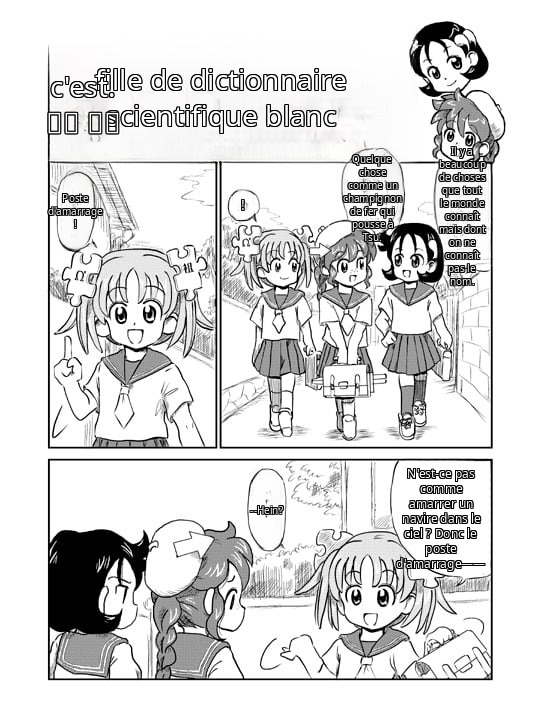

# Comic Translate 4 Free

Idioma: [English](../README.md) · [हिन्दी](README.hi.md) · [日本語](README.ja.md) · [한국어](README.ko.md) · [简体中文](README.zh-CN.md) · [繁體中文](README.zh-TW.md) · [Español](README.es.md) · [العربية](README.ar.md) · [Français](README.fr.md) · [বাংলা](README.bn.md) · [Português](README.pt.md) · [Русский](README.ru.md) · [Tiếng Việt](README.vi.md) · [Bahasa Indonesia](README.id.md) · [اردو](README.ur.md) · [Deutsch](README.de.md) · [Română](README.ro.md)

¡Lee manga en tu idioma, directamente en el navegador!

Comic Translate 4 Free traduce páginas de manga y cómics automáticamente mientras navegas. Lee japonés, inglés, chino simplificado y tradicional (con detección automática) y traduce a 114 idiomas. Abre una página y la versión traducida reemplaza la imagen original en su lugar, con los bocadillos llenos de tu idioma.

### 📸 Antes y después

| Antes (japonés) | Después (español) |
| --- | --- |
|  |  |

See translations in 14 more languages

| Hindi | Korean | Simplified Chinese |
| --- | --- | --- |
|  |  |  |

| Traditional Chinese | Spanish | Arabic |
| --- | --- | --- |
|  |  |  |

| French | Bengali | Portuguese |
| --- | --- | --- |
|  |  |  |

| Russian | Vietnamese | Indonesian |
| --- | --- | --- |
|  |  |  |

| Urdu | German |
| --- | --- |
|  |  |

*Ilustración original de Wikipe-tan por Kasuga, del [artículo Manga de Wikipedia](https://en.wikipedia.org/wiki/Manga) vía Wikimedia Commons — con licencia [CC BY-SA 3.0](https://creativecommons.org/licenses/by-sa/3.0/). Las capturas traducidas son obras derivadas modificadas del original.*

---

## ✨ Funciones

- Traducción automática (Pro) — abre una página de manga en un sitio permitido y la versión traducida aparece en su lugar, sin necesidad de hacer clic en ningún botón. Gratis hasta 50 imágenes al día; ilimitada con Pro.
- Cada imagen en la página — la traducción automática gestiona todas las imágenes de una página (hasta 50 por ejecución), no solo la imagen principal.
- Pretraducir la página siguiente (Pro) — mientras lees la página actual, la imagen de la página siguiente se traduce en segundo plano, así está lista en cuanto la abres (solo una imagen; activado por defecto, se puede desactivar en Ajustes). Gratis hasta 50 imágenes al día; ilimitada con Pro.
- Cambio automático de motor — si el motor de traducción seleccionado falla o devuelve texto en el idioma equivocado, la extensión prueba automáticamente otro. Gratis, siempre activado.
- OCR (testing) — un motor de OCR de prueba rápido para páginas en japonés. Actívalo en Ajustes, en Debug. Mucho más rápido en el móvil.
- Una pestaña a la vez — mientras una pestaña está traduciendo, el botón Translate de la otra pestaña aparece atenuado. Cancelar dice «Cancel other tab».
- Clic derecho en cualquier imagen — elige "Enviar a Comic Translate 4 Free" para traducir una imagen concreta, incluso si es más pequeña que el tamaño mínimo.
- 114 idiomas de destino con Google Translator, Gemini, Azure Translator o tu propio servidor local de LM Studio.
- Detección automática del idioma de origen — japonés, inglés, chino simplificado/tradicional se identifican automáticamente a partir del texto leído por OCR.
- Soporte para tiras largas / webtoon — las páginas altas se procesan en segmentos superpuestos para que el texto se mantenga nítido.
- 17 idiomas de interfaz — la interfaz de la extensión sigue el ajuste de idioma de tu navegador.
- El idioma de destino es por defecto el idioma de tu navegador — puedes cambiarlo cuando quieras en Ajustes.

### 🔒 Privacidad

- La IA se ejecuta en tu equipo. La detección de bocadillos, el OCR y el inpainting se ejecutan localmente en tu navegador. La detección y el OCR se ejecutan con WebAssembly. El inpainting se ejecuta con GPU en Chrome (con WebAssembly como alternativa) y con WebAssembly en Firefox. Tus páginas nunca salen de tu dispositivo.
- Solo se envía el texto traducido — solo las cadenas extraídas van al servicio de traducción que elijas (Google / Gemini / Azure / tu LM Studio local).
- Sin cuenta, sin rastreo, sin telemetría. Todos los ajustes y modelos en caché permanecen en el almacenamiento local de tu navegador.

---

## 🚀 Instalación

Chrome / Edge / Brave:

[Instalar desde Chrome Web Store](https://chromewebstore.google.com/detail/pndooikgcenncdohfggodonniihplppj) — un clic, actualizaciones automáticas.

Firefox:

[Instalar desde Firefox Add-ons](https://addons.mozilla.org/en-US/firefox/addon/comic-translate-4-free/) — un clic, actualizaciones automáticas.

Después de instalar, los modelos se descargan automáticamente en segundo plano (~350 MB: detector, OCR, inpainter). Se guardan en caché en el navegador y se verifican por tamaño en bytes. Si una traducción empieza antes de que terminen, espera a que terminen.

---

## 💡 Cómo usarlo

1. Permite primero el sitio — haz clic en el icono de la extensión y pulsa Permitir este sitio (o activa Permitir todos los sitios). La traducción solo se ejecuta donde hayas concedido permiso.

   

2. Recarga la página de manga — empieza a traducir automáticamente cuando se carga la página. Una píldora en la parte superior derecha muestra el progreso en vivo (Capturing → Detecting → OCR → …).
3. Listo — las imágenes de la página se reemplazan en su lugar con las versiones traducidas.

Consejos:
- Clic derecho en cualquier imagen → Enviar a Comic Translate 4 Free para traducir solo esa imagen.

  

- Si un sitio bloquea las descargas (HTTP 403), la extensión reintenta automáticamente a través de una pestaña en segundo plano.
- Elige tu motor de traducción en Ajustes: Google Translator (gratis, sin clave), Gemini (se requiere clave, recomendado — mejor traducción de manga), Azure Translator (se está retirando) o LM Studio (servidor local).

---

## 🔑 Obtener una clave de API de Gemini

Gemini ofrece las mejores traducciones de manga. Para usarlo como motor de traducción:

1. Abre [Google AI Studio](https://aistudio.google.com/apikey) y haz clic en "Create API key"
2. Elige o crea un proyecto de Google Cloud si se te pide
3. Copia la clave
4. Pégala en el campo Clave de API de Gemini en los Ajustes de la extensión y haz clic en "Comprobar la conexión de Gemini"
5. Elige Gemini como motor de traducción en Ajustes

---

## 💎 Pro

Las traducciones cuentan para el límite gratuito de 50 imágenes al día mientras alguna función Pro esté activada. Una imagen cuenta como una, sea cual sea su altura. Desactiva las dos funciones Pro y traducir es gratis e ilimitado. La traducción automática y la pretraducción son funciones Pro: gratis hasta 50 imágenes al día, ilimitadas con una suscripción Pro.

- $3/mes o $30/año
- Compra una clave de licencia, pégala en el campo «License key» en los Ajustes de la extensión y haz clic en «Activate Pro». La clave funciona en 2 navegadores.
- Cuando llegues al límite gratuito de 50 imágenes, una ventana emergente te lo recordará una vez al día. Después de valorar la extensión, Get Pro pasa a ser «Copy Discount Code: 5STARS»: tócalo para copiar el código y abrir el pago.

---

## ⚠️ Problemas conocidos

- Aún no hay OCR de coreano — los idiomas de origen son japonés, inglés y chino simplificado/tradicional. (El coreano sigue disponible como idioma de traducción.)
- Sesiones grandes — traducir decenas de imágenes en una sola sesión puede reiniciar la extensión en segundo plano. Si eso ocurre, la ejecución se reanuda automáticamente desde donde lo dejó.
- Firefox — los modelos se ejecutan en la página en segundo plano (sin documentos offscreen), compartiendo memoria con todo lo demás. Reinicia el navegador si ves "no available backend found".
- Firefox es más lento que Chrome — las extensiones de Firefox no pueden usar memoria compartida para multihilo (SharedArrayBuffer), por lo que el modelo se ejecuta en un solo hilo de CPU. Esto es un límite de la plataforma Firefox, no un error de la extensión. ([Bug de Mozilla 1673477](https://bugzilla.mozilla.org/show_bug.cgi?id=1673477)).
- Google Translator usa el endpoint gratuito no oficial y puede tener límite de velocidad.

---

## 📄 Avisos de terceros

Este proyecto está inspirado en [ogkalu2/comic-translate](https://github.com/ogkalu2/comic-translate) — el detector de bocadillos/texto y el inpainter LaMa entrenado con manga son sus exportaciones ONNX, y la lógica de inferencia está portada de él. (El OCR usa [Baberu](https://huggingface.co/genshiai-daichi/baberu-ocr) de genshiai-daichi.)

Las bibliotecas incluidas, el código portado y los modelos descargados en tiempo de ejecución se enumeran con sus licencias en [THIRD-PARTY-NOTICES.md](../THIRD-PARTY-NOTICES.md).

PolyForm Noncommercial License 1.0.0 — ver [LICENSE](../LICENSE).
