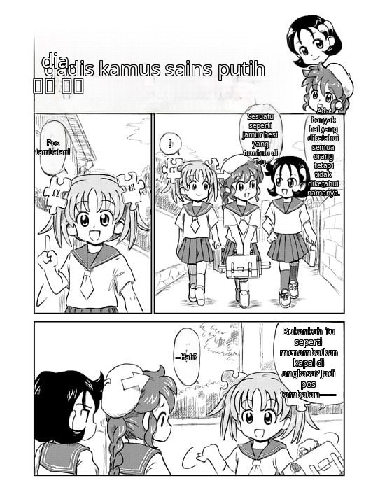

# Comic Translate 4 Free

भाषा: [English](../README.md) · [हिन्दी](README.hi.md) · [日本語](README.ja.md) · [한국어](README.ko.md) · [简体中文](README.zh-CN.md) · [繁體中文](README.zh-TW.md) · [Español](README.es.md) · [العربية](README.ar.md) · [Français](README.fr.md) · [বাংলা](README.bn.md) · [Português](README.pt.md) · [Русский](README.ru.md) · [Tiếng Việt](README.vi.md) · [Bahasa Indonesia](README.id.md) · [اردو](README.ur.md) · [Deutsch](README.de.md) · [Română](README.ro.md)

अपनी भाषा में मंगा पढ़ें — सीधे ब्राउज़र में।

Comic Translate 4 Free ब्राउज़ करते समय मंगा और कॉमिक पेजों का स्वचालित रूप से अनुवाद करता है। यह जापानी, अंग्रेज़ी, सरलीकृत और पारंपरिक चीनी पढ़ता है (ऑटो-डिटेक्ट के साथ), और 114 भाषाओं में अनुवाद करता है। कोई पेज खोलें, और अनुवादित संस्करण मूल छवि की जगह ले लेता है — स्पीच बबल आपकी भाषा से भरे होते हैं।

### 📸 पहले और बाद में

| पहले (जापानी) | बाद में (हिन्दी) |
| --- | --- |
|  |  |

14 और भाषाओं में अनुवाद देखें

| हिन्दी | कोरियाई | सरलीकृत चीनी |
| --- | --- | --- |
|  |  |  |

| पारंपरिक चीनी | स्पैनिश | अरबी |
| --- | --- | --- |
|  |  |  |

| फ्रांसीसी | बांग्ला | पुर्तगाली |
| --- | --- | --- |
|  |  |  |

| रूसी | वियतनामी | इंडोनेशियाई |
| --- | --- | --- |
|  |  |  |

| उर्दू | जर्मन |
| --- | --- |
|  |  |

*Kasuga द्वारा बनाई गई मूल Wikipe-tan चित्रकारी, [Wikipedia के Manga लेख](https://en.wikipedia.org/wiki/Manga) से, Wikimedia Commons के माध्यम से — [CC BY-SA 3.0](https://creativecommons.org/licenses/by-sa/3.0/) के तहत लाइसेंस प्राप्त। अनूदित स्क्रीनशॉट मूल के संशोधित व्युत्पन्न कार्य हैं।*

---

## ✨ विशेषताएँ

- स्वचालित अनुवाद (Pro) — अनुमत साइट पर मंगा पेज खोलें और अनुवादित संस्करण वहीं दिखाई देगा, कोई बटन दबाने की ज़रूरत नहीं। प्रतिदिन 50 छवियों तक मुफ़्त; Pro के साथ असीमित।
- पेज की हर तस्वीर — ऑटो-ट्रांसलेट एक पेज की सभी तस्वीरों का अनुवाद करता है (प्रति रन अधिकतम 50), सिर्फ मुख्य छवि का नहीं।
- अगला पृष्ठ पहले से अनुवाद करें (Pro) — जब आप वर्तमान पृष्ठ पढ़ रहे हों, तब अगले पृष्ठ की तस्वीर बैकग्राउंड में अनुवाद हो जाती है, इसलिए खोलते ही वह तैयार रहती है (केवल एक तस्वीर; डिफ़ॉल्ट रूप से चालू, सेटिंग्स से बंद किया जा सकता है)। प्रतिदिन 50 छवियों तक मुफ़्त; Pro के साथ असीमित।
- इंजन फ़ेलओवर — यदि चुना गया अनुवाद इंजन विफल हो जाता है, या गलत भाषा में पाठ देता है, तो एक्सटेंशन स्वचालित रूप से दूसरा इंजन आज़माता है। मुफ़्त, हमेशा चालू।
- OCR (परीक्षण) — जापानी पेजों के लिए एक तेज़ परीक्षण OCR इंजन। सेटिंग्स में, डीबग के अंतर्गत इसे चालू करें। फ़ोन पर बहुत तेज़।
- एक समय में एक टैब — जब एक टैब अनुवाद कर रहा हो, तो दूसरे टैब का अनुवाद बटन धूसर हो जाता है। रद्द करें पर 'दूसरा टैब रद्द करें' लिखा होता है।
- किसी भी छवि पर राइट-क्लिक करें — किसी विशिष्ट तस्वीर का अनुवाद करने के लिए "Send to Comic Translate 4 Free" चुनें, भले ही वह न्यूनतम आकार से छोटी हो।
- Google Translator, Gemini, Azure Translator, या अपने स्वयं के स्थानीय LM Studio सर्वर के माध्यम से 114 लक्षित भाषाएँ।
- स्रोत भाषा ऑटो-डिटेक्ट — OCR किए गए पाठ से जापानी, अंग्रेज़ी, सरलीकृत/पारंपरिक चीनी स्वचालित रूप से पहचानी जाती है।
- लंबी स्ट्रिप / वेबटून समर्थन — लंबे पेजों को ओवरलैपिंग खंडों में संसाधित किया जाता है ताकि पाठ स्पष्ट रहे।
- 17 UI भाषाएँ — एक्सटेंशन इंटरफ़ेस आपके ब्राउज़र की भाषा सेटिंग का पालन करता है।
- लक्षित भाषा डिफ़ॉल्ट रूप से आपके ब्राउज़र की भाषा होती है — इसे सेटिंग्स में कभी भी बदलें।

### 🔒 गोपनीयता

- AI आपकी मशीन पर चलता है। बबल डिटेक्शन, OCR और inpainting सभी आपके ब्राउज़र में स्थानीय रूप से चलते हैं। डिटेक्शन और OCR WebAssembly के माध्यम से चलते हैं। Inpainting Chrome में GPU पर चलता है (WebAssembly फ़ॉलबैक के साथ), और Firefox में WebAssembly के माध्यम से। आपके पेज कभी आपका डिवाइस नहीं छोड़ते।
- केवल अनुवादित पाठ ही बाहर भेजा जाता है — केवल निकाले गए स्ट्रिंग आपकी चुनी हुई अनुवाद सेवा तक जाते हैं (Google / Gemini / Azure / आपका स्थानीय LM Studio)।
- कोई खाता नहीं, कोई ट्रैकिंग नहीं, कोई टेलीमेट्री नहीं। सभी सेटिंग्स और कैश किए गए मॉडल आपके ब्राउज़र के स्थानीय स्टोरेज में रहते हैं।

---

## 🚀 इंस्टॉलेशन

Chrome / Edge / Brave:

[Chrome Web Store से इंस्टॉल करें](https://chromewebstore.google.com/detail/pndooikgcenncdohfggodonniihplppj) — एक क्लिक में, ऑटोमैटिक अपडेट के साथ।

Firefox:

[Firefox Add-ons से इंस्टॉल करें](https://addons.mozilla.org/en-US/firefox/addon/comic-translate-4-free/) — एक क्लिक, स्वचालित अपडेट।

इंस्टॉल करने के बाद, मॉडल पृष्ठभूमि में स्वचालित रूप से डाउनलोड हो जाते हैं (~350 MB: डिटेक्टर, OCR, इनपेंटर)। वे ब्राउज़र में कैश होते हैं और बाइट आकार से सत्यापित होते हैं। यदि कोई अनुवाद समाप्त होने से पहले शुरू होता है, तो यह उनकी प्रतीक्षा करता है।

---

## 💡 कैसे उपयोग करें

1. पहले साइट को अनुमति दें — एक्सटेंशन आइकन पर क्लिक करें और इस साइट को अनुमति दें दबाएँ (या सभी साइटों को अनुमति दें चालू करें)। अनुवाद केवल वहीं चलता है जहाँ आपने अनुमति दी है।

   

2. मंगा पेज को रीलोड करें — पेज लोड होते ही यह स्वचालित रूप से अनुवाद शुरू कर देता है। ऊपर-दाईं ओर एक पिल लाइव प्रगति दिखाती है (Capturing → Detecting → OCR → …)।
3. हो गया — पेज की तस्वीरें वहीं अनुवादित संस्करणों से बदल जाती हैं।

सुझाव:
- किसी भी छवि पर राइट-क्लिक करें → सिर्फ़ उस तस्वीर का अनुवाद करने के लिए Send to Comic Translate 4 Free।

  

- यदि कोई साइट डाउनलोड ब्लॉक करती है (HTTP 403), एक्सटेंशन बैकग्राउंड टैब के माध्यम से स्वचालित रूप से पुनः प्रयास करता है।
- सेटिंग्स में अपना अनुवाद इंजन चुनें: Google Translator (कोई कुंजी नहीं), Gemini (कुंजी ज़रूरी, अनुशंसित — बेहतर मंगा अनुवाद), Azure Translator (रिटायर किया जा रहा है), या LM Studio (स्थानीय सर्वर)।

---

## 🔑 Gemini API कुंजी प्राप्त करें

Gemini सबसे बेहतरीन मंगा अनुवाद देता है। इसे अनुवाद इंजन के रूप में उपयोग करने के लिए:

1. [Google AI Studio](https://aistudio.google.com/apikey) खोलें और "Create API key" पर क्लिक करें
2. यदि पूछा जाए तो Google Cloud प्रोजेक्ट चुनें या बनाएं
3. कुंजी कॉपी करें
4. इसे एक्सटेंशन की सेटिंग्स में 'Gemini API की' फ़ील्ड में पेस्ट करें, फिर 'Gemini कनेक्शन जांचें' पर क्लिक करें
5. सेटिंग्स में अनुवाद इंजन के रूप में Gemini चुनें

---

## 💎 Pro

जब कोई भी Pro सुविधा चालू हो, तब अनुवाद प्रतिदिन की मुफ़्त 50 छवियों में गिने जाते हैं। एक छवि एक ही गिनी जाती है, चाहे उसकी ऊंचाई कुछ भी हो। दोनों Pro सुविधाएँ बंद कर दें तो अनुवाद मुफ़्त और असीमित हो जाता है। ऑटो-ट्रांसलेट और प्री-ट्रांसलेट Pro सुविधाएँ हैं — प्रतिदिन 50 छवियों तक मुफ़्त, Pro सदस्यता के साथ असीमित।

- $3/माह या $30/वर्ष
- लाइसेंस कुंजी खरीदें, उसे एक्सटेंशन की सेटिंग्स में 'लाइसेंस कुंजी' फ़ील्ड में पेस्ट करें, और 'Pro सक्रिय करें' पर क्लिक करें। कुंजी 2 ब्राउज़रों पर काम करती है।
- जब आप 50 छवियों की मुफ़्त सीमा तक पहुँचते हैं, तो एक पॉपअप दिन में एक बार आपको याद दिलाता है। एक्सटेंशन को रेट करने के बाद, Pro पाएं बदलकर 'डिस्काउंट कोड कॉपी करें: 5STARS' हो जाता है — कोड कॉपी करने और चेकआउट खोलने के लिए इसे टैप करें।

---

## ⚠️ ज्ञात समस्याएँ

- अभी तक कोरियाई OCR नहीं — स्रोत भाषाएँ जापानी, अंग्रेज़ी, और सरलीकृत/पारंपरिक चीनी हैं। (कोरियाई अनुवाद लक्ष्य भाषा के रूप में उपलब्ध रहती है।)
- बड़े सेशन — एक सेशन में दर्जनों छवियों का अनुवाद करने से एक्सटेंशन बैकग्राउंड में रीस्टार्ट हो सकता है। ऐसा होने पर, रन वहीं से अपने आप फिर से शुरू हो जाता है जहाँ वह रुका था।
- Firefox — मॉडल बैकग्राउंड पेज में चलते हैं (offscreen दस्तावेज़ों के बिना), बाकी सबके साथ मेमोरी साझा करते हुए। "no available backend found" दिखे तो ब्राउज़र रीस्टार्ट करें।
- Firefox Chrome से धीमा है — Firefox एक्सटेंशन मल्टी-थ्रेडिंग के लिए शेयर्ड मेमोरी (SharedArrayBuffer) का उपयोग नहीं कर सकते, इसलिए मॉडल एक ही CPU थ्रेड पर चलता है। यह एक्सटेंशन का बग नहीं, Firefox प्लेटफ़ॉर्म की सीमा है ([Mozilla bug 1673477](https://bugzilla.mozilla.org/show_bug.cgi?id=1673477))।
- Google Translator अनौपचारिक मुफ़्त एंडपॉइंट का उपयोग करता है और रेट-सीमित हो सकता है।

---

## 📄 तृतीय-पक्ष सूचनाएँ

यह परियोजना [ogkalu2/comic-translate](https://github.com/ogkalu2/comic-translate) से प्रेरित है — बबल/टेक्स्ट डिटेक्टर और मंगा-प्रशिक्षित LaMa इनपेंटर इसके ONNX एक्सपोर्ट हैं, और इनफरेंस लॉजिक इससे पोर्ट किया गया है। (OCR genshiai-daichi का [Baberu](https://huggingface.co/genshiai-daichi/baberu-ocr) उपयोग करता है।)

बंडल की गई लाइब्रेरी, पोर्ट किया गया कोड और रनटाइम में डाउनलोड किए गए मॉडल अपने लाइसेंस के साथ [THIRD-PARTY-NOTICES.md](../THIRD-PARTY-NOTICES.md) में सूचीबद्ध हैं।

PolyForm Noncommercial License 1.0.0 — [LICENSE](../LICENSE) देखें।
