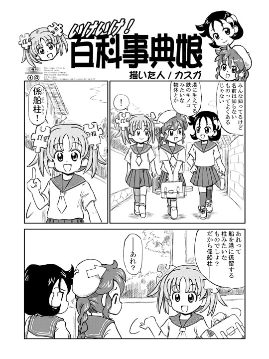
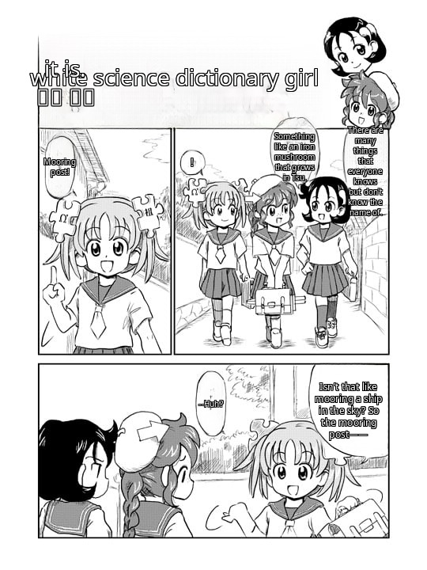
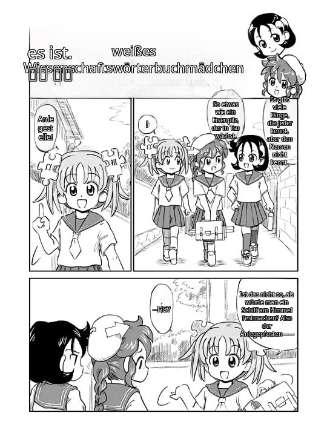
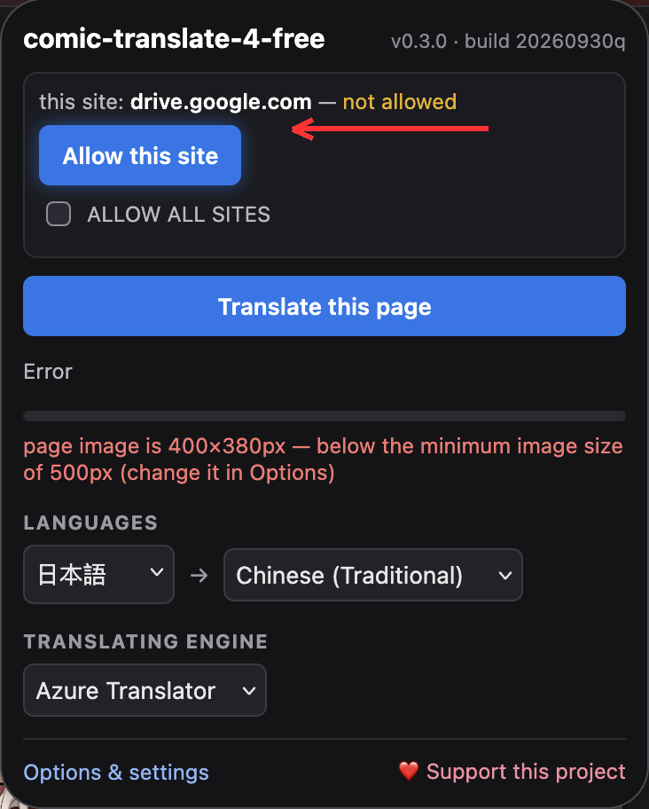

# Comic Translate 4 Free

言語： [English](../README.md) · [हिन्दी](README.hi.md) · [日本語](README.ja.md) · [한국어](README.ko.md) · [简体中文](README.zh-CN.md) · [繁體中文](README.zh-TW.md) · [Español](README.es.md) · [العربية](README.ar.md) · [Français](README.fr.md) · [বাংলা](README.bn.md) · [Português](README.pt.md) · [Русский](README.ru.md) · [Tiếng Việt](README.vi.md) · [Bahasa Indonesia](README.id.md) · [اردو](README.ur.md) · [Deutsch](README.de.md) · [Română](README.ro.md)

あなたの言語でマンガを読もう — ブラウザの中で直接。

Comic Translate 4 Free はブラウジング中にマンガやコミックのページを自動で翻訳します。日本語、英語、簡体字/繁体字中国語を読み取り（自動検出）、114言語に翻訳します。ページを開くと、翻訳版が元の画像とその場で置き換わります — 吹き出しがあなたの言語で満たされます。

### 📸 ビフォア & アフター

| ビフォア（日本語） | アフター（英語） |
| --- | --- |
|  |  |

他の 14 言語への翻訳を見る

| ヒンディー語 | 韓国語 | 簡体字中国語 |
| --- | --- | --- |
|  |  |  |

| 繁体字中国語 | スペイン語 | アラビア語 |
| --- | --- | --- |
|  |  |  |

| フランス語 | ベンガル語 | ポルトガル語 |
| --- | --- | --- |
|  |  |  |

| ロシア語 | ベトナム語 | インドネシア語 |
| --- | --- | --- |
|  |  |  |

| ウルドゥー語 | ドイツ語 |
| --- | --- |
|  |  |

*Kasuga氏による Wikipe-tan の原画（[Wikipedia の Manga の記事](https://en.wikipedia.org/wiki/Manga)より、Wikimedia Commons 経由）— [CC BY-SA 3.0](https://creativecommons.org/licenses/by-sa/3.0/) の下でライセンスされています。翻訳後のスクリーンショットは、原画を改変した二次的著作物です。*

---

## ✨ 機能

- 自動翻訳（Pro） — 許可したサイトでマンガのページを開くと、翻訳版がその場に表示されます。ボタンを押す必要はありません。1日50枚まで無料、Proなら無制限。
- ページのすべての画像 — 自動翻訳はページ上のすべての画像を処理します（1 回の実行で最大 50 枚まで）。メイン画像だけではありません。
- 次のページを事前に翻訳（Pro） — 現在のページを読んでいる間に、次のページの画像がバックグラウンドで翻訳され、開いた瞬間に準備ができています（画像は 1 枚のみ。デフォルトでオン、設定でオフにできます）。1日50枚まで無料、Proなら無制限。
- エンジンのフェイルオーバー — 選択した翻訳エンジンが失敗した場合や、間違った言語のテキストを返した場合、拡張機能は自動的に別のエンジンを試します。無料で、常にオンです。
- OCR（テスト） — 日本語ページ用の高速なテスト用 OCR エンジンです。設定の「デバッグ」の下でオンにします。スマートフォンではるかに高速です。
- 一度に1つのタブ — あるタブが翻訳している間、他のタブの「翻訳」はグレーアウトします。「キャンセル」は「他のタブをキャンセル」と表示されます。
- 任意の画像を右クリック — 「Comic Translate 4 Free に送信」を選ぶと、特定の画像を翻訳できます。最小サイズより小さい画像でも翻訳できます。
- 114 の対象言語 — Google Translator、Gemini、Azure Translator、または自分のローカル LM Studio サーバーで 114 の対象言語に対応。
- ソース言語の自動検出 — OCR で読み取ったテキストから、日本語、英語、簡体字/繁体字中国語を自動で識別します。
- 縦長ストリップ / ウェブトゥーン対応 — 縦長のページは重なり合うセグメントで処理されるため、テキストがシャープなままです。
- 17 の UI 言語 — 拡張機能のインターフェースはブラウザの言語設定に従います。
- 対象言語はデフォルトでブラウザの言語になります — 設定でいつでも変更できます。

### 🔒 プライバシー

- AI はあなたのコンピューター上で動作します。吹き出し検出、OCR、インペインティングはすべてブラウザ内でローカルに動作します。検出と OCR は WebAssembly で動作します。インペインティングは Chrome では GPU で動作し（WebAssembly にフォールバック）、Firefox では WebAssembly で動作します。あなたのページがデバイスから出ることは決してありません。
- 送信されるのは翻訳されたテキストだけです — 抽出された文字列だけが、あなたが選んだ翻訳サービス（Google / Gemini / Azure / ローカルの LM Studio）に送られます。
- アカウント不要、トラッキングなし、テレメトリなし。すべての設定とキャッシュされたモデルはブラウザのローカルストレージに残ります。

---

## 🚀 インストール

Chrome / Edge / Brave:

[Chrome ウェブストアからインストール](https://chromewebstore.google.com/detail/pndooikgcenncdohfggodonniihplppj) — ワンクリックで、自動更新されます。

Firefox:

[Firefox Add-ons からインストール](https://addons.mozilla.org/en-US/firefox/addon/comic-translate-4-free/) — ワンクリックで、自動更新。

インストール後、モデルはバックグラウンドで自動的にダウンロードされます（約350MB：検出器、OCR、インペインター）。ブラウザにキャッシュされ、バイトサイズで検証されます。ダウンロードが終わる前に翻訳が始まった場合、翻訳はモデルのダウンロードが終わるのを待ちます。

---

## 💡 使い方

1. まずサイトを許可する — 拡張機能のアイコンをクリックし、このサイトを許可を押します（またはすべてのサイトを許可を有効にします）。翻訳は、許可を与えた場所でのみ動作します。

   

2. マンガのページを再読み込みする — ページが読み込まれると自動で翻訳が始まります。右上のピルがライブの進捗を表示します（Capturing → Detecting → OCR → …）。
3. 完了 — ページの画像がその場で翻訳版に置き換わります。

ヒント：
- 任意の画像を右クリック → Comic Translate 4 Free に送信で、その画像だけを翻訳します。

  

- サイトがダウンロードをブロックする場合（HTTP 403）、拡張機能はバックグラウンドタブ経由で自動的に再試行します。
- 設定で翻訳エンジンを選んでください：Google Translator（キー不要）、Gemini（キー必須、推奨 — より良いマンガ翻訳）、Azure Translator（廃止予定）、または LM Studio（ローカルサーバー）。

---

## 🔑 Gemini APIキーを取得する

Gemini は最高のマンガ翻訳を提供します。翻訳エンジンとして使うには：

1. [Google AI Studio](https://aistudio.google.com/apikey) を開き、「APIキーを作成」をクリックする
2. 求められた場合は Google Cloud プロジェクトを選択または作成する
3. キーをコピーする
4. 拡張機能の設定にある「Gemini APIキー」欄に貼り付け、「Gemini接続を確認」をクリックする
5. 設定で Gemini を翻訳エンジンとして選択する

---

## 💎 Pro

いずれかの Pro 機能がオンの間、翻訳は 1 日あたり無料 50 枚にカウントされます。1 枚の画像は高さに関わらず 1 枚としてカウントされます。両方の Pro 機能をオフにすると、翻訳は無料で無制限になります。自動翻訳と事前翻訳は Pro 機能です — 1 日 50 枚まで無料、Pro サブスクリプションなら無制限。

- $3/月または$30/年
- ライセンスキーを購入し、拡張機能の設定にある「ライセンスキー」欄に貼り付けて、「Pro を有効化」をクリックします。キーは 2 つのブラウザで使えます。
- 無料の 50 枚の制限に達すると、ポップアップが 1 日に 1 回お知らせします。拡張機能を評価すると、「Pro を入手」が「割引コードをコピー：5STARS」になります — タップするとコードがコピーされ、チェックアウトが開きます。

---

## ⚠️ 既知の問題

- 韓国語の OCR はまだありません — ソース言語は日本語、英語、簡体字/繁体字中国語です。（韓国語は翻訳対象言語として引き続き利用できます。）
- 大量のセッション — 1 回のセッションで数十枚の画像を翻訳すると、拡張機能がバックグラウンドで再起動することがあります。その場合は、中断したところから自動的に再開します。
- Firefox — モデルはバックグラウンドページで動作し（オフスクリーンドキュメントなし）、他のすべてとメモリを共有します。「no available backend found」と表示されたら、ブラウザを再起動してください。
- Firefox は Chrome より遅いです — Firefox 拡張機能はマルチスレッド用の共有メモリ（SharedArrayBuffer）を使用できないため、モデルは 1 つの CPU スレッドで動作します。これは拡張機能のバグではなく、Firefox プラットフォームの制限です。([Mozilla バグ 1673477](https://bugzilla.mozilla.org/show_bug.cgi?id=1673477))
- Google Translator は非公式の無料エンドポイントを使用しており、レート制限される場合があります。

---

## 📄 サードパーティに関する通知

このプロジェクトは [ogkalu2/comic-translate](https://github.com/ogkalu2/comic-translate) に着想を得ています — 吹き出し/テキスト検出器とマンガで学習した LaMa インペインターはその ONNX エクスポートであり、推論ロジックはそこから移植されています。（OCR は genshiai-daichi の [Baberu](https://huggingface.co/genshiai-daichi/baberu-ocr) を使用しています。）

バンドルされたライブラリ、移植されたコード、実行時にダウンロードされるモデルは、ライセンスとともに [THIRD-PARTY-NOTICES.md](../THIRD-PARTY-NOTICES.md) に記載されています。

PolyForm Noncommercial License 1.0.0 — [LICENSE](../LICENSE) を参照。
