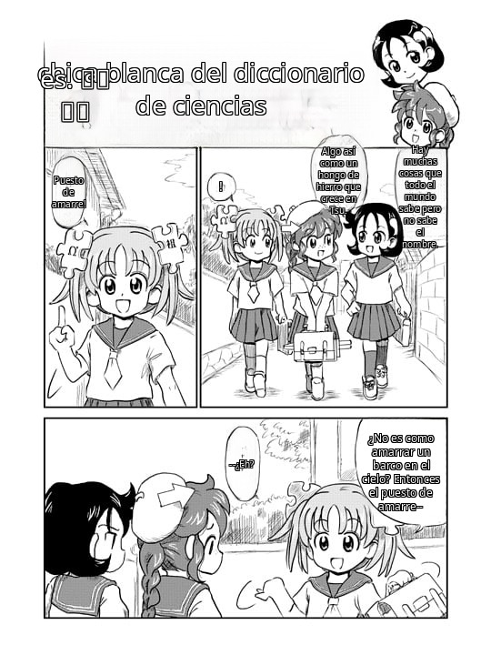

# Comic Translate 4 Free

언어: [English](../README.md) · [हिन्दी](README.hi.md) · [日本語](README.ja.md) · [한국어](README.ko.md) · [简体中文](README.zh-CN.md) · [繁體中文](README.zh-TW.md) · [Español](README.es.md) · [العربية](README.ar.md) · [Français](README.fr.md) · [বাংলা](README.bn.md) · [Português](README.pt.md) · [Русский](README.ru.md) · [Tiếng Việt](README.vi.md) · [Bahasa Indonesia](README.id.md) · [اردو](README.ur.md) · [Deutsch](README.de.md) · [Română](README.ro.md)

당신의 언어로 만화를 읽으세요 — 바로 브라우저에서.

Comic Translate 4 Free는 브라우징하는 동안 만화와 코믹을 자동으로 번역합니다. 일본어, 영어, 간체/번체 중국어를 읽고(자동 감지), 114개 언어로 번역합니다. 페이지를 열면 번역된 버전이 원본 이미지를 그 자리에서 대체합니다 — 말풍선이 당신의 언어로 채워집니다.

### 📸 전 / 후

| 전 (일본어) | 후 (한국어) |
| --- | --- |
|  |  |

14개 언어로의 번역 결과 더 보기

| 힌디어 | 한국어 | 중국어(간체) |
| --- | --- | --- |
|  |  |  |

| 중국어(번체) | 스페인어 | 아랍어 |
| --- | --- | --- |
|  |  |  |

| 프랑스어 | 벵골어 | 포르투갈어 |
| --- | --- | --- |
|  |  |  |

| 러시아어 | 베트남어 | 인도네시아어 |
| --- | --- | --- |
|  |  |  |

| 우르두어 | 독일어 |
| --- | --- |
|  |  |

*Kasuga가 그린 원본 Wikipe-tan 일러스트([Wikipedia의 Manga 문서](https://en.wikipedia.org/wiki/Manga), Wikimedia Commons 경유) — [CC BY-SA 3.0](https://creativecommons.org/licenses/by-sa/3.0/) 라이선스. 번역된 스크린샷은 원본을 수정한 2차적 저작물입니다.*

---

## ✨ 기능

- 자동 번역 (Pro) — 허용된 사이트에서 만화 페이지를 열면 번역된 버전이 그 자리에 나타나며, 버튼을 누를 필요가 없습니다. 하루 50장까지 무료, Pro에서는 무제한.
- 페이지의 모든 이미지 — 자동 번역은 페이지의 모든 이미지를 처리합니다 (실행당 최대 50개), 메인 이미지만이 아닙니다.
- 다음 페이지 미리 번역 (Pro) — 현재 페이지를 읽는 동안 다음 페이지의 이미지가 백그라운드에서 번역되어, 열자마자 바로 준비되어 있습니다(한 장만 해당, 기본적으로 켜져 있으며 설정에서 끌 수 있습니다). 하루 50장까지 무료, Pro에서는 무제한.
- 엔진 폴백 — 선택한 번역 엔진이 실패하거나 잘못된 언어로 텍스트를 반환하면, 확장 프로그램이 자동으로 다른 엔진을 시도합니다. 무료, 항상 켜져 있습니다.
- OCR (testing) — 일본어 페이지를 위한 빠른 테스트 OCR 엔진. 설정의 디버그에서 켜세요. 휴대폰에서 훨씬 빠릅니다.
- 한 번에 하나의 탭 — 하나의 탭에서 번역하는 동안 다른 탭의 번역 버튼은 비활성화됩니다. 취소 버튼에는 "Cancel other tab"이라고 표시됩니다.
- 모든 이미지를 마우스 오른쪽 버튼으로 클릭 — "Comic Translate 4 Free로 보내기"를 선택하면 특정 이미지를 번역할 수 있으며, 최소 크기보다 작은 이미지도 가능합니다.
- Google Translator, Gemini, Azure Translator 또는 자신의 로컬 LM Studio 서버를 통한 114개 대상 언어.
- 원본 언어 자동 감지 — OCR로 읽은 텍스트에서 일본어, 영어, 간체/번체 중국어가 자동으로 식별됩니다.
- 긴 스트립 / 웹툰 지원 — 긴 페이지는 겹치는 구간으로 처리되어 텍스트가 선명하게 유지됩니다.
- 17개 UI 언어 — 확장 프로그램 인터페이스는 브라우저의 언어 설정을 따릅니다.
- 대상 언어는 기본적으로 브라우저 언어로 설정됩니다 — 설정에서 언제든지 변경할 수 있습니다.

### 🔒 개인정보 보호

- AI는 당신의 컴퓨터에서 실행됩니다. 말풍선 감지, OCR, 인페인팅은 모두 브라우저 안에서 로컬로 실행됩니다. 감지와 OCR은 WebAssembly로 실행됩니다. 인페인팅은 Chrome에서는 GPU로 실행되고(WebAssembly 폴백 포함), Firefox에서는 WebAssembly로 실행됩니다. 당신의 페이지는 절대 기기를 떠나지 않습니다.
- 번역된 텍스트만 외부로 전송됩니다 — 추출된 문자열만 당신이 선택한 번역 서비스(Google / Gemini / Azure / 로컬 LM Studio)로 전송됩니다.
- 계정 없음, 추적 없음, 텔레메트리 없음. 모든 설정과 캐시된 모델은 브라우저의 로컬 저장소에 남아 있습니다.

---

## 🚀 설치

Chrome / Edge / Brave:

[Chrome 웹 스토어에서 설치](https://chromewebstore.google.com/detail/pndooikgcenncdohfggodonniihplppj) — 한 번의 클릭으로 자동 업데이트됩니다.

Firefox:

[Firefox 부가 기능에서 설치](https://addons.mozilla.org/en-US/firefox/addon/comic-translate-4-free/) — 한 번의 클릭으로, 자동 업데이트.

설치 후 모델은 백그라운드에서 자동으로 다운로드됩니다(약 350MB: 감지기, OCR, 인페인터). 브라우저에 캐시되고 바이트 크기로 검증됩니다. 다운로드가 끝나기 전에 번역이 시작되면 번역은 모델이 준비될 때까지 기다립니다.

---

## 💡 사용 방법

1. 먼저 사이트를 허용하세요 — 확장 프로그램 아이콘을 클릭하고 이 사이트 허용을 누르세요(또는 모든 사이트 허용을 활성화하세요). 번역은 권한을 부여한 곳에서만 실행됩니다.

   

2. 만화 페이지를 새로고침하세요 — 페이지가 로드되면 자동으로 번역이 시작됩니다. 오른쪽 상단의 표시가 실시간 진행 상황을 보여줍니다(Capturing → Detecting → OCR → …).
3. 완료 — 페이지의 이미지가 그 자리에서 번역된 버전으로 대체됩니다.

팁:
- 모든 이미지를 마우스 오른쪽 버튼으로 클릭 → Comic Translate 4 Free로 보내기를 선택해 해당 이미지만 번역하세요.

  

- 사이트가 다운로드를 차단하면(HTTP 403), 확장 프로그램이 백그라운드 탭을 통해 자동으로 다시 시도합니다.
- 설정에서 번역 엔진을 선택하세요: Google Translator(키 불필요), Gemini(키 필요, 권장 — 더 나은 만화 번역), Azure Translator(지원 종료 예정) 또는 LM Studio(로컬 서버).

---

## 🔑 Gemini API 키 받기

Gemini는 최고의 만화 번역을 제공합니다. 번역 엔진으로 사용하려면:

1. [Google AI Studio](https://aistudio.google.com/apikey)를 열고 "Create API key"를 클릭하세요
2. 요청 시 Google Cloud 프로젝트를 선택하거나 생성하세요
3. 키를 복사하세요
4. 확장 프로그램 설정의 Gemini API 키 필드에 붙여넣은 다음 "Gemini 연결 확인"을 클릭하세요
5. 설정에서 번역 엔진으로 Gemini를 선택하세요

---

## 💎 Pro

Pro 기능 중 하나라도 켜져 있으면 번역이 하루 무료 50장에 포함됩니다. 이미지는 높이에 관계없이 한 장으로 셉니다. 두 Pro 기능을 모두 끄면 번역은 무료이며 무제한입니다. 자동 번역과 미리 번역은 Pro 기능입니다 — 하루 50장까지 무료, Pro 구독 시 무제한.

- 월 $3 또는 연 $30
- 라이선스 키를 구매해 확장 프로그램 설정의 라이선스 키 필드에 붙여넣고 Activate Pro를 클릭하세요. 키는 2개의 브라우저에서 사용할 수 있습니다.
- 무료 50장 한도에 도달하면 하루에 한 번 팝업이 알려줍니다. 확장 프로그램에 별점을 준 뒤에는 Get Pro가 "Copy Discount Code: 5STARS"로 바뀝니다 — 탭하면 코드가 복사되고 결제 화면이 열립니다.

---

## ⚠️ 알려진 문제

- 아직 한국어 OCR이 없습니다 — 원본 언어는 일본어, 영어, 간체/번체 중국어입니다. (한국어는 번역 대상 언어로 계속 사용할 수 있습니다.)
- 대용량 세션 — 한 세션에서 수십 개의 이미지를 번역하면 백그라운드에서 확장 프로그램이 다시 시작될 수 있습니다. 그런 경우 실행은 중단된 지점부터 자동으로 다시 시작됩니다.
- Firefox — 모델이 백그라운드 페이지에서 실행되며(오프스크린 문서 없음), 다른 모든 것과 메모리를 공유합니다. "no available backend found"가 표시되면 브라우저를 다시 시작하세요.
- Firefox는 Chrome보다 느립니다 — Firefox 확장 프로그램은 멀티스레딩용 공유 메모리(SharedArrayBuffer)를 사용할 수 없으므로 모델이 하나의 CPU 스레드에서 실행됩니다. 이는 확장 프로그램의 버그가 아니라 Firefox 플랫폼의 한계입니다. ([Mozilla 버그 1673477](https://bugzilla.mozilla.org/show_bug.cgi?id=1673477))
- Google Translator는 비공식 무료 엔드포인트를 사용하며 속도 제한이 적용될 수 있습니다.

---

## 📄 타사 고지

이 프로젝트는 [ogkalu2/comic-translate](https://github.com/ogkalu2/comic-translate)에서 영감을 받았습니다 — 말풍선/텍스트 감지기와 만화로 학습한 LaMa 인페인터는 해당 프로젝트의 ONNX 내보내기이며, 추론 로직은 거기서 가져온 것입니다. (OCR은 genshiai-daichi의 [Baberu](https://huggingface.co/genshiai-daichi/baberu-ocr)를 사용합니다.)

번들된 라이브러리, 이식된 코드, 런타임에 다운로드되는 모델은 라이선스와 함께 [THIRD-PARTY-NOTICES.md](../THIRD-PARTY-NOTICES.md)에 나열되어 있습니다.

PolyForm Noncommercial License 1.0.0 — [LICENSE](../LICENSE)를 참조하세요.
