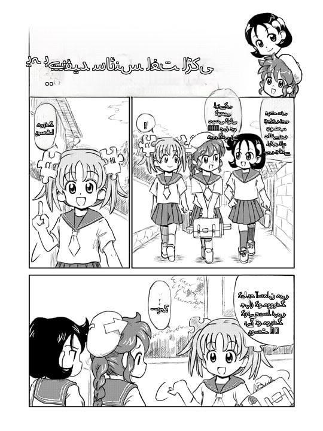

# Comic Translate 4 Free

Language: [English](../README.md) · [हिन्दी](README.hi.md) · [日本語](README.ja.md) · [한국어](README.ko.md) · [简体中文](README.zh-CN.md) · [繁體中文](README.zh-TW.md) · [Español](README.es.md) · [العربية](README.ar.md) · [Français](README.fr.md) · [বাংলা](README.bn.md) · [Português](README.pt.md) · [Русский](README.ru.md) · [Tiếng Việt](README.vi.md) · [Bahasa Indonesia](README.id.md) · [اردو](README.ur.md) · [Deutsch](README.de.md) · [Română](README.ro.md)

Leia mangá no seu idioma — direto no navegador.

Comic Translate 4 Free traduz mangá e quadrinhos automaticamente enquanto você navega. Ele lê japonês, inglês, chinês simplificado/tradicional (detecção automática) e traduz para 114 idiomas. Abra uma página e a versão traduzida substitui a imagem original no lugar — com os balões de fala preenchidos com o seu idioma.

### 📸 Antes e depois

| Antes (japonês) | Depois (português) |
| --- | --- |
|  |  |

Ver traduções em mais 14 idiomas

| hindi | coreano | chinês simplificado |
| --- | --- | --- |
|  |  |  |

| chinês tradicional | espanhol | árabe |
| --- | --- | --- |
|  |  |  |

| francês | bengali | português |
| --- | --- | --- |
|  |  |  |

| russo | vietnamita | indonésio |
| --- | --- | --- |
|  |  |  |

| urdu | alemão |
| --- | --- |
|  |  |

*Ilustração Wikipe-tan original por Kasuga, do [artigo Manga da Wikipedia](https://en.wikipedia.org/wiki/Manga) via Wikimedia Commons — licenciada sob [CC BY-SA 3.0](https://creativecommons.org/licenses/by-sa/3.0/). As capturas traduzidas são obras derivadas modificadas do original.*

---

## ✨ Recursos

- Tradução automática (Pro) — abra uma página de mangá em um site permitido e a versão traduzida aparece no lugar, sem precisar clicar em nenhum botão. Grátis para 50 imagens por dia; ilimitado com o Pro.
- Cada imagem na página — a tradução automática cuida de todas as imagens da página (até 50 por execução), não apenas a imagem principal.
- Pré-traduzir a próxima página (Pro) — enquanto você lê a página atual, a imagem da próxima página é traduzida em segundo plano, então já está pronta quando você a abre (apenas uma imagem; ativado por padrão, pode ser desativado nas Configurações). Grátis para 50 imagens por dia; ilimitado com o Pro.
- Failover de mecanismo — se o mecanismo de tradução selecionado falhar ou devolver texto no idioma errado, a extensão tenta automaticamente outro. Grátis, sempre ativado.
- OCR (testing) — um mecanismo de OCR de teste rápido para páginas em japonês. Ative-o em Configurações, em Depuração. Bem mais rápido em celulares.
- Uma aba por vez — enquanto uma aba está traduzindo, o botão Traduzir da outra aba fica esmaecido. O botão Cancelar mostra "Cancel other tab".
- Clique com o botão direito em qualquer imagem — escolha "Enviar para Comic Translate 4 Free" para traduzir uma imagem específica, mesmo que seja menor que o tamanho mínimo.
- 114 idiomas de destino via Google Translator, Gemini, Azure Translator ou o seu próprio servidor local LM Studio.
- Detecção automática do idioma de origem — japonês, inglês, chinês simplificado/tradicional identificados automaticamente a partir do texto lido por OCR.
- Suporte a tiras longas / webtoon — páginas altas são processadas em segmentos sobrepostos para que o texto fique nítido.
- 17 idiomas de interface — a interface da extensão segue a configuração de idioma do seu navegador.
- O idioma de destino usa por padrão o idioma do seu navegador — altere-o a qualquer momento em Configurações.

### 🔒 Privacidade

- A IA roda na sua máquina. A detecção de balões, o OCR e o inpainting rodam todos localmente no seu navegador. A detecção e o OCR rodam via WebAssembly. O inpainting roda na GPU no Chrome (com fallback para WebAssembly) e via WebAssembly no Firefox. Suas páginas nunca saem do seu dispositivo.
- Apenas o texto traduzido é enviado — apenas as strings extraídas vão para o serviço de tradução que você escolher (Google / Gemini / Azure / seu LM Studio local).
- Sem conta, sem rastreamento, sem telemetria. Todas as configurações e modelos em cache ficam no armazenamento local do seu navegador.

---

## 🚀 Instalação

Chrome / Edge / Brave:

[Instalar da Chrome Web Store](https://chromewebstore.google.com/detail/pndooikgcenncdohfggodonniihplppj) — um clique, atualizações automáticas.

Firefox:

[Instalar do Firefox Add-ons](https://addons.mozilla.org/en-US/firefox/addon/comic-translate-4-free/) — um clique, atualizações automáticas.

Após instalar, os modelos são baixados automaticamente em segundo plano (~350 MB: detector, OCR, inpainter). Eles ficam em cache no navegador e são verificados pelo tamanho em bytes. Se uma tradução começar antes de os modelos terminarem de baixar, ela espera por eles.

---

## 💡 Como usar

1. Permita o site primeiro — clique no ícone da extensão e pressione Permitir este site (ou ative Permitir todos os sites). A tradução só roda onde você concedeu permissão.

   

2. Recarregue a página do mangá — ela começa a traduzir automaticamente ao carregar. Uma pílula no canto superior direito mostra o progresso ao vivo (Capturing → Detecting → OCR → …).
3. Pronto — as imagens da página são substituídas no lugar pelas versões traduzidas.

Dicas:
- Clique com o botão direito em qualquer imagem → Enviar para Comic Translate 4 Free para traduzir só aquela imagem.

  

- Se um site bloquear downloads (HTTP 403), a extensão tenta novamente automaticamente por meio de uma aba em segundo plano.
- Escolha seu mecanismo de tradução em Configurações: Google Translator (sem chave), Gemini (chave necessária, recomendado — melhor tradução de mangá), Azure Translator (sendo descontinuado) ou LM Studio (servidor local).

---

## 🔑 Obter uma chave de API do Gemini

O Gemini oferece as melhores traduções de mangá. Para usá-lo como mecanismo de tradução:

1. Abra o [Google AI Studio](https://aistudio.google.com/apikey) e clique em "Create API key"
2. Escolha ou crie um projeto do Google Cloud, se solicitado
3. Copie a chave
4. Cole-a no campo Chave de API do Gemini nas Configurações da extensão e clique em "Testar conexão do Gemini"
5. Escolha Gemini como mecanismo de tradução em Configurações

---

## 💎 Pro

As traduções contam para o limite gratuito de 50 imagens por dia enquanto qualquer recurso Pro estiver ativado. Uma imagem conta como uma, seja qual for a sua altura. Desative os dois recursos Pro e a tradução fica gratuita e ilimitada. A tradução automática e a pré-tradução são recursos Pro — grátis para 50 imagens por dia, ilimitados com uma assinatura Pro.

- $3/mês ou $30/ano
- Compre uma chave de licença, cole-a no campo Chave de licença nas Configurações da extensão e clique em Activate Pro. A chave funciona em 2 navegadores.
- Quando você atingir o limite gratuito de 50 imagens, um popup lembrará você uma vez por dia. Depois de avaliar a extensão, o botão Get Pro passa a mostrar "Copy Discount Code: 5STARS" — toque nele para copiar o código e abrir o checkout.

---

## ⚠️ Problemas conhecidos

- Ainda não há OCR de coreano — os idiomas de origem são japonês, inglês e chinês simplificado/tradicional. (O coreano continua disponível como idioma de tradução.)
- Sessões grandes — traduzir dezenas de imagens em uma sessão pode reiniciar a extensão em segundo plano. Se isso acontecer, a execução retoma automaticamente de onde parou.
- Firefox — os modelos rodam na página de fundo (sem documentos offscreen), compartilhando memória com todo o resto. Reinicie o navegador se vir "no available backend found".
- O Firefox é mais lento que o Chrome — as extensões do Firefox não podem usar memória compartilhada para multithreading (SharedArrayBuffer), então o modelo roda em um único thread de CPU. Isso é um limite da plataforma Firefox, não um bug da extensão. ([Bug da Mozilla 1673477](https://bugzilla.mozilla.org/show_bug.cgi?id=1673477)).
- O Google Translator usa o endpoint gratuito não oficial e pode ter limite de taxa.

---

## 📄 Avisos de terceiros

Este projeto é inspirado em [ogkalu2/comic-translate](https://github.com/ogkalu2/comic-translate) — o detector de balões/texto e o inpainter LaMa treinado com mangá são suas exportações ONNX, e a lógica de inferência foi portada dele. (O OCR usa [Baberu](https://huggingface.co/genshiai-daichi/baberu-ocr) de genshiai-daichi.)

As bibliotecas incluídas, o código portado e os modelos baixados em tempo de execução estão listados com suas licenças em [THIRD-PARTY-NOTICES.md](../THIRD-PARTY-NOTICES.md).

PolyForm Noncommercial License 1.0.0 — ver [LICENSE](../LICENSE).
