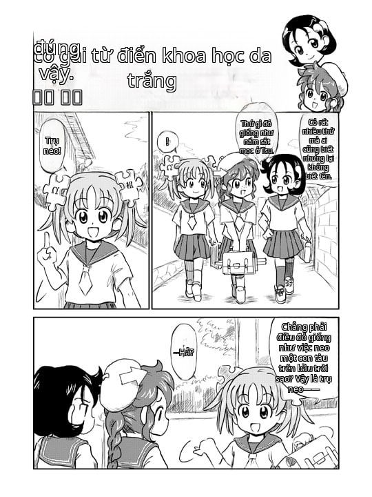

# Comic Translate 4 Free

Язык: [English](../README.md) · [हिन्दी](README.hi.md) · [日本語](README.ja.md) · [한국어](README.ko.md) · [简体中文](README.zh-CN.md) · [繁體中文](README.zh-TW.md) · [Español](README.es.md) · [العربية](README.ar.md) · [Français](README.fr.md) · [বাংলা](README.bn.md) · [Português](README.pt.md) · [Русский](README.ru.md) · [Tiếng Việt](README.vi.md) · [Bahasa Indonesia](README.id.md) · [اردو](README.ur.md) · [Deutsch](README.de.md) · [Română](README.ro.md)

Читайте мангу на своём языке — прямо в браузере.

Comic Translate 4 Free автоматически переводит мангу и комиксы при просмотре. Читает японский, английский, упрощённый/традиционный китайский (автоопределение) и переводит на 114 языков. Откройте страницу, и переведённая версия заменит исходное изображение на месте — облачка с текстом будут заполнены на вашем языке.

### 📸 До и после

| До (японский) | После (русский) |
| --- | --- |
|  |  |

См. переводы ещё на 14 языках

| Hindi | Korean | Simplified Chinese |
| --- | --- | --- |
|  |  |  |

| Traditional Chinese | Spanish | Arabic |
| --- | --- | --- |
|  |  |  |

| French | Bengali | Portuguese |
| --- | --- | --- |
|  |  |  |

| Russian | Vietnamese | Indonesian |
| --- | --- | --- |
|  |  |  |

| Urdu | German |
| --- | --- |
|  |  |

*Оригинальная иллюстрация Wikipe-tan художника Kasuga, из [статьи «Манга» в Википедии](https://en.wikipedia.org/wiki/Manga) через Wikimedia Commons — лицензия [CC BY-SA 3.0](https://creativecommons.org/licenses/by-sa/3.0/). Переведённые скриншоты являются изменёнными производными произведениями оригинала.*

---

## ✨ Возможности

- Автоматический перевод (Pro) — откройте страницу манги на разрешённом сайте, и переведённая версия появится на месте, без нажатия кнопок. Бесплатно — 50 изображений в день; с Pro — без ограничений.
- Каждое изображение на странице — автоперевод обрабатывает все изображения на странице (до 50 за запуск), а не только основное изображение.
- Заранее перевести следующую страницу (Pro) — пока вы читаете текущую страницу, изображение следующей страницы переводится в фоне, поэтому оно готово, как только вы её откроете (только одно изображение; по умолчанию включено, отключается в настройках). Бесплатно — 50 изображений в день; с Pro — без ограничений.
- Переключение движка при сбое — если выбранный движок перевода не сработал или вернул текст на неверном языке, расширение автоматически пробует другой. Бесплатно, всегда включено.
- OCR (testing) — быстрый тестовый движок OCR для страниц на японском. Включите его в настройках, в разделе «Отладка». На телефонах работает гораздо быстрее.
- Одна вкладка за раз — пока одна вкладка переводит, кнопка перевода в другой вкладке неактивна. На кнопке отмены написано "Cancel other tab".
- Щёлкните правой кнопкой мыши по любому изображению — выберите «Отправить в Comic Translate 4 Free», чтобы перевести конкретную картинку, даже если она меньше минимального размера.
- 114 целевых языков через Google Translator, Gemini, Azure Translator или ваш собственный локальный сервер LM Studio.
- Автоопределение исходного языка — японский, английский, упрощённый/традиционный китайский определяются автоматически по тексту, распознанному OCR.
- Поддержка длинных полос / вебтунов — высокие страницы обрабатываются перекрывающимися сегментами, чтобы текст оставался чётким.
- 17 языков интерфейса — интерфейс расширения следует языковой настройке вашего браузера.
- Целевой язык по умолчанию соответствует языку вашего браузера — меняйте его в любое время в настройках.

### 🔒 Конфиденциальность

- ИИ работает на вашем компьютере. Обнаружение облачков, OCR и инпейнтинг выполняются локально в вашем браузере. Обнаружение и OCR работают через WebAssembly. Инпейнтинг работает на GPU в Chrome (с откатом на WebAssembly) и через WebAssembly в Firefox. Ваши страницы никогда не покидают ваше устройство.
- Отправляется только переведённый текст — только извлечённые строки уходят в выбранный вами сервис перевода (Google / Gemini / Azure / ваш локальный LM Studio).
- Без учётной записи, без отслеживания, без телеметрии. Все настройки и кэшированные модели остаются в локальном хранилище вашего браузера.

---

## 🚀 Установка

Chrome / Edge / Brave:

[Установить из Chrome Web Store](https://chromewebstore.google.com/detail/pndooikgcenncdohfggodonniihplppj) — один клик, автоматические обновления.

Firefox:

[Установить из Firefox Add-ons](https://addons.mozilla.org/en-US/firefox/addon/comic-translate-4-free/) — один клик, автоматические обновления.

После установки модели загружаются автоматически в фоновом режиме (~350 МБ: детектор, OCR, инпейнтер). Они кэшируются в браузере и проверяются по размеру в байтах. Если перевод начнётся до того, как они загрузятся, он подождёт их.

---

## 💡 Как пользоваться

1. Сначала разрешите сайт — нажмите на значок расширения и нажмите Разрешить этот сайт (или включите Разрешить все сайты). Перевод работает только там, где вы дали разрешение.

   

2. Перезагрузите страницу манги — перевод начнётся автоматически при загрузке страницы. Пилюля в правом верхнем углу показывает прогресс в реальном времени (Capturing → Detecting → OCR → …).
3. Готово — картинки страницы заменяются на месте переведёнными версиями.

Советы:
- Щёлкните правой кнопкой мыши по любому изображению → Отправить в Comic Translate 4 Free, чтобы перевести только эту картинку.

  

- Если сайт блокирует загрузки (HTTP 403), расширение автоматически повторяет попытку через фоновую вкладку.
- Выберите движок перевода в настройках: Google Translator (без ключа), Gemini (требуется ключ, рекомендуется — лучший перевод манги), Azure Translator (выводится из эксплуатации) или LM Studio (локальный сервер).

---

## 🔑 Получить ключ API Gemini

Gemini даёт лучший перевод манги. Чтобы использовать его в качестве движка перевода:

1. Откройте [Google AI Studio](https://aistudio.google.com/apikey) и нажмите «Create API key»
2. Выберите или создайте проект Google Cloud, если потребуется
3. Скопируйте ключ
4. Вставьте его в поле Ключ API Gemini в настройках расширения и нажмите «Проверить соединение с Gemini»
5. Выберите Gemini в качестве движка перевода в настройках

---

## 💎 Pro

Пока включена хотя бы одна функция Pro, переводы засчитываются в бесплатный лимит — 50 изображений в день. Одно изображение считается за одно, какой бы высоты оно ни было. Отключите обе функции Pro — и перевод станет бесплатным и безлимитным. Автоперевод и предперевод — это функции Pro: бесплатно 50 изображений в день, без ограничений — с подпиской Pro.

- $3/месяц или $30/год
- Купите лицензионный ключ, вставьте его в поле «Лицензионный ключ» в настройках расширения и нажмите Activate Pro. Ключ работает в 2 браузерах.
- Когда вы исчерпаете бесплатный лимит в 50 изображений, всплывающее окно будет напоминать об этом раз в день. После того как вы оцените расширение, кнопка Get Pro станет "Copy Discount Code: 5STARS" — нажмите её, чтобы скопировать код и открыть страницу оплаты.

---

## ⚠️ Известные проблемы

- Пока нет OCR для корейского — языки оригинала: японский, английский и упрощённый/традиционный китайский. (Корейский по-прежнему доступен как язык перевода.)
- Большие сессии — перевод десятков изображений за одну сессию может перезапустить расширение в фоне. Если это происходит, запуск автоматически возобновляется с того места, где остановился.
- Firefox — модели работают на фоновой странице (без offscreen-документов), разделяя память со всем остальным. Перезапустите браузер, если увидите «no available backend found».
- Firefox медленнее Chrome — расширения Firefox не могут использовать общую память для многопоточности (SharedArrayBuffer), поэтому модель работает на одном потоке CPU. Это ограничение платформы Firefox, а не ошибка расширения ([Баг Mozilla 1673477](https://bugzilla.mozilla.org/show_bug.cgi?id=1673477)).
- Google Translator использует неофициальную бесплатную конечную точку и может быть ограничен по скорости.

---

## 📄 Уведомления третьих сторон

Этот проект вдохновлён [ogkalu2/comic-translate](https://github.com/ogkalu2/comic-translate) — детектор облачков/текста и обученный на манге инпейнтер LaMa являются его ONNX-экспортами, а логика вывода портирована из него. (OCR использует [Baberu](https://huggingface.co/genshiai-daichi/baberu-ocr) от genshiai-daichi.)

Включённые библиотеки, портированный код и модели, загружаемые во время работы, перечислены вместе с их лицензиями в [THIRD-PARTY-NOTICES.md](../THIRD-PARTY-NOTICES.md).

PolyForm Noncommercial License 1.0.0 — см. [LICENSE](../LICENSE).
