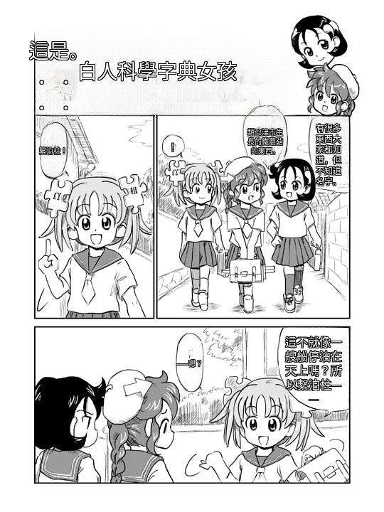

# Comic Translate 4 Free

زبان: [English](../README.md) · [हिन्दी](README.hi.md) · [日本語](README.ja.md) · [한국어](README.ko.md) · [简体中文](README.zh-CN.md) · [繁體中文](README.zh-TW.md) · [Español](README.es.md) · [العربية](README.ar.md) · [Français](README.fr.md) · [বাংলা](README.bn.md) · [Português](README.pt.md) · [Русский](README.ru.md) · [Tiếng Việt](README.vi.md) · [Bahasa Indonesia](README.id.md) · [اردو](README.ur.md) · [Deutsch](README.de.md) · [Română](README.ro.md)

اپنی زبان میں مانگا پڑھیں — براؤزر میں ہی۔

Comic Translate 4 Free براؤز کرتے وقت مانگا اور کامک کے صفحات کا خودکار ترجمہ کرتا ہے۔ یہ جاپانی، انگریزی، سادہ اور روایتی چینی پڑھتا ہے (خودکار شناخت کے ساتھ)، اور 114 زبانوں میں ترجمہ کرتا ہے۔ صفحہ کھولیں، اور ترجمہ شدہ ورژن اصل تصویر کی جگہ لے لیتا ہے — مکالمے کے بلبلے آپ کی زبان سے بھر جاتے ہیں۔

### 📸 پہلے اور بعد میں

| پہلے (جاپانی) | بعد میں (اردو) |
| --- | --- |
|  |  |

دیگر 14 زبانوں میں ترجمے دیکھیں

| Hindi | Korean | Simplified Chinese |
| --- | --- | --- |
|  |  |  |

| Traditional Chinese | Spanish | Arabic |
| --- | --- | --- |
|  |  |  |

| French | Bengali | Portuguese |
| --- | --- | --- |
|  |  |  |

| Russian | Vietnamese | Indonesian |
| --- | --- | --- |
|  |  |  |

| Urdu | German |
| --- | --- |
|  |  |

*Kasuga کی بنائی ہوئی اصل Wikipe-tan تصویر، [Wikipedia کے Manga مضمون](https://en.wikipedia.org/wiki/Manga) سے، Wikimedia Commons کے ذریعے — [CC BY-SA 3.0](https://creativecommons.org/licenses/by-sa/3.0/) کے تحت لائسنس یافتہ۔ ترجمہ شدہ اسکرین شاٹس اصل کے ترمیم شدہ مشتق کام ہیں۔*

---

## ✨ خصوصیات

- خودکار ترجمہ (Pro) — اجازت یافتہ سائٹ پر مانگا صفحہ کھولیں اور ترجمہ شدہ ورژن وہیں ظاہر ہوگا، کسی بٹن کو دبانے کی ضرورت نہیں۔ روزانہ 50 تصاویر تک مفت؛ Pro کے ساتھ لامحدود۔
- صفحے کی ہر تصویر — خودکار ترجمہ صفحے کی تمام تصاویر کا ترجمہ کرتا ہے (فی بار 50 تک)، صرف مرکزی تصویر کا نہیں۔
- اگلا صفحہ پہلے سے ترجمہ کریں (Pro) — جب آپ موجودہ صفحہ پڑھ رہے ہوں تو اگلے صفحے کی تصویر پس منظر میں ترجمہ ہو جاتی ہے، اس لیے کھولتے ہی تیار ہوتی ہے (صرف ایک تصویر؛ بطور ڈیفالٹ آن، سیٹنگز سے بند کیا جا سکتا ہے)۔ روزانہ 50 تصاویر تک مفت؛ Pro کے ساتھ لامحدود۔
- انجن فیل اوور — اگر منتخب کردہ ترجمہ انجن ناکام ہو جائے، یا غلط زبان میں متن واپس کرے، تو ایکسٹینشن خودکار طور پر دوسرا انجن آزماتی ہے۔ مفت، ہمیشہ آن۔
- OCR (تجرباتی) — جاپانی صفحات کے لیے ایک تیز تجرباتی OCR انجن۔ اسے سیٹنگز میں Debug کے تحت آن کریں۔ فون پر بہت تیز۔
- ایک وقت میں ایک ٹیب — جب ایک ٹیب ترجمہ کر رہا ہو تو دوسرے ٹیب کا Translate دھندلا ہوتا ہے۔ Cancel پر "Cancel other tab" لکھا ہوتا ہے۔
- کسی بھی تصویر پر رائٹ کلک کریں — کسی مخصوص تصویر کا ترجمہ کرنے کے لیے "Send to Comic Translate 4 Free" منتخب کریں، چاہے وہ کم از کم سائز سے چھوٹی ہو۔
- Google Translator، Gemini، Azure Translator، یا آپ کے اپنے مقامی LM Studio سرور کے ذریعے 114 ہدف زبانیں۔
- ماخذ زبان کی خودکار شناخت — OCR شدہ متن سے جاپانی، انگریزی، سادہ/روایتی چینی خودکار طور پر پہچانی جاتی ہے۔
- لمبی پٹی / ویب ٹون سپورٹ — لمبے صفحات اوورلیپنگ حصوں میں پروسیس کیے جاتے ہیں تاکہ متن واضح رہے۔
- 17 UI زبانیں — ایکسٹینشن کا انٹرفیس آپ کے براؤزر کی زبان کی ترتیب پر عمل کرتا ہے۔
- ہدف زبان ڈیفالٹ طور پر آپ کے براؤزر کی زبان کے مطابق ہوتی ہے — اسے ترتیبات میں کسی بھی وقت تبدیل کریں۔

### 🔒 رازداری

- AI آپ کی مشین پر چلتا ہے۔ بلبلے کی شناخت، OCR اور inpainting سب آپ کے براؤزر میں مقامی طور پر چلتے ہیں۔ شناخت اور OCR WebAssembly کے ذریعے چلتے ہیں۔ Inpainting Chrome میں GPU پر چلتا ہے (WebAssembly فال بیک کے ساتھ)، اور Firefox میں WebAssembly کے ذریعے۔ آپ کے صفحات کبھی آپ کا آلہ نہیں چھوڑتے۔
- صرف ترجمہ شدہ متن باہر بھیجا جاتا ہے — صرف نکالی گئی سٹرنگز آپ کی منتخب کردہ ترجمہ سروس (Google / Gemini / Azure / آپ کا مقامی LM Studio) تک جاتی ہیں۔
- کوئی اکاؤنٹ نہیں، کوئی ٹریکنگ نہیں، کوئی ٹیلی میٹری نہیں۔ تمام ترتیبات اور کیش شدہ ماڈل آپ کے براؤزر کی مقامی اسٹوریج میں رہتے ہیں۔

---

## 🚀 انسٹالیشن

Chrome / Edge / Brave:

[Chrome Web Store سے انسٹال کریں](https://chromewebstore.google.com/detail/pndooikgcenncdohfggodonniihplppj) — ایک کلک، خودکار اپڈیٹس۔

Firefox:

[Firefox Add-ons سے انسٹال کریں](https://addons.mozilla.org/en-US/firefox/addon/comic-translate-4-free/) — ایک کلک، خودکار اپڈیٹس۔

انسٹال کرنے کے بعد، ماڈلز خود بخود بیک گراؤنڈ میں ڈاؤن لوڈ ہو جاتے ہیں (~350 MB: ڈیٹیکٹر، OCR، انپینٹر)۔ یہ براؤزر میں کیش کیے جاتے ہیں اور بائٹ سائز کے حساب سے تصدیق کیے جاتے ہیں۔ اگر ترجمہ مکمل ہونے سے پہلے شروع ہو جائے تو وہ ان کا انتظار کرتا ہے۔

---

## 💡 استعمال کا طریقہ

1. پہلے سائٹ کو اجازت دیں — ایکسٹینشن آئیکن پر کلک کریں اور اس سائٹ کو اجازت دیں دبائیں (یا تمام سائٹس کو اجازت دیں فعال کریں)۔ ترجمہ صرف وہیں چلتا ہے جہاں آپ نے اجازت دی ہے۔

   

2. مانگا صفحہ دوبارہ لوڈ کریں — صفحہ لوڈ ہوتے ہی یہ خودکار طور پر ترجمہ شروع کر دیتا ہے۔ اوپر دائیں جانب ایک پل لائیو پیش رفت دکھاتی ہے (Capturing → Detecting → OCR → …)۔
3. ہو گیا — صفحے کی تصاویر وہیں ترجمہ شدہ ورژن سے بدل جاتی ہیں۔

ٹپس:
- کسی بھی تصویر پر رائٹ کلک کریں → صرف اس تصویر کا ترجمہ کرنے کے لیے Send to Comic Translate 4 Free۔

  

- اگر کوئی سائٹ ڈاؤن لوڈ بلاک کرتی ہے (HTTP 403)، ایکسٹینشن بیک گراؤنڈ ٹیب کے ذریعے خودکار طور پر دوبارہ کوشش کرتا ہے۔
- ترتیبات میں اپنا ترجمہ انجن منتخب کریں: Google Translator (کوئی کلید نہیں)، Gemini (کلید درکار، تجویز کردہ — بہتر مانگا ترجمہ)، Azure Translator (ریٹائر کیا جا رہا ہے)، یا LM Studio (مقامی سرور)۔

---

## 🔑 Gemini API کی حاصل کریں

Gemini بہترین مانگا تراجم فراہم کرتا ہے۔ اسے ترجمہ انجن کے طور پر استعمال کرنے کے لیے:

1. [Google AI Studio](https://aistudio.google.com/apikey) کھولیں اور "Create API key" پر کلک کریں
2. اگر پوچھا جائے تو Google Cloud پروجیکٹ منتخب کریں یا بنائیں
3. کی کاپی کریں
4. اسے ایکسٹینشن کی ترتیبات میں Gemini API کی فیلڈ میں پیسٹ کریں، پھر "Gemini کنکشن چیک کریں" پر کلک کریں
5. ترتیبات میں Gemini کو ترجمہ انجن کے طور پر منتخب کریں۔

---

## 💎 Pro

جب کوئی Pro فیچر آن ہو تو ترجمے روزانہ مفت 50 تصاویر میں شمار ہوتے ہیں۔ ایک تصویر ایک ہی شمار ہوتی ہے، چاہے اس کی اونچائی کچھ بھی ہو۔ دونوں Pro فیچر بند کر دیں تو ترجمہ مفت اور لامحدود ہو جاتا ہے۔ خودکار ترجمہ اور پہلے سے ترجمہ Pro فیچر ہیں — روزانہ 50 تصاویر تک مفت، Pro سبسکرپشن کے ساتھ لامحدود۔

- $3/مہینہ یا $30/سال
- لائسنس کی خریدیں، اسے ایکسٹینشن کی سیٹنگز میں License key فیلڈ میں پیسٹ کریں، اور Activate Pro پر کلک کریں۔ یہ کی 2 براؤزرز پر کام کرتی ہے۔
- جب آپ 50 تصاویر کی مفت حد تک پہنچ جائیں تو ایک پاپ اپ دن میں ایک بار یاد دلاتا ہے۔ ایکسٹینشن کو ریٹ کرنے کے بعد، Get Pro بدل کر "Copy Discount Code: 5STARS" ہو جاتا ہے — اس پر ٹیپ کریں تو کوڈ کاپی ہو جاتا ہے اور چیک آؤٹ کھل جاتا ہے۔

---

## ⚠️ معلوم مسائل

- ابھی تک کورین OCR نہیں — ماخذ زبانیں جاپانی، انگریزی، اور سادہ/روایتی چینی ہیں۔ (کورین ترجمہ ہدف زبان کے طور پر دستیاب رہتی ہے۔)
- بڑے سیشن — ایک سیشن میں درجنوں تصاویر کا ترجمہ کرنے سے ایکسٹینشن پس منظر میں دوبارہ شروع ہو سکتی ہے۔ اگر ایسا ہو جائے تو رن خود بخود وہیں سے دوبارہ شروع ہو جاتا ہے جہاں سے رکا تھا۔
- Firefox — ماڈل بیک گراؤنڈ صفحے میں چلتے ہیں (offscreen دستاویزات کے بغیر)، باقی سب کے ساتھ میموری شیئر کرتے ہوئے۔ "no available backend found" نظر آئے تو براؤزر دوبارہ شروع کریں۔
- Firefox Chrome سے سست ہے — Firefox ایکسٹینشن ملٹی تھریڈنگ کے لیے مشترکہ میموری (SharedArrayBuffer) استعمال نہیں کر سکتے، اس لیے ماڈل ایک ہی CPU تھریڈ پر چلتا ہے۔ یہ ایکسٹینشن کی غلطی نہیں، Firefox پلیٹ فارم کی حد ہے ([Mozilla بگ 1673477](https://bugzilla.mozilla.org/show_bug.cgi?id=1673477))۔
- Google Translator غیر سرکاری مفت اینڈ پوائنٹ استعمال کرتا ہے اور ریٹ محدود ہو سکتا ہے۔

---

## 📄 فریق ثالث کی اطلاعات

یہ منصوبہ [ogkalu2/comic-translate](https://github.com/ogkalu2/comic-translate) سے متاثر ہے — بلبلے/متن ڈیٹیکٹر اور مانگا سے تربیت یافتہ LaMa انپینٹر اس کے ONNX ایکسپورٹ ہیں، اور انفرنس منطق اس سے پورٹ کی گئی ہے۔ (OCR genshiai-daichi کا [Baberu](https://huggingface.co/genshiai-daichi/baberu-ocr) استعمال کرتا ہے۔)

بنڈل شدہ لائبریریاں، پورٹ کیا گیا کوڈ اور رن ٹائم میں ڈاؤن لوڈ کیے گئے ماڈل اپنے لائسنس کے ساتھ [THIRD-PARTY-NOTICES.md](../THIRD-PARTY-NOTICES.md) میں درج ہیں۔

PolyForm Noncommercial License 1.0.0 — [LICENSE](../LICENSE) دیکھیں۔
