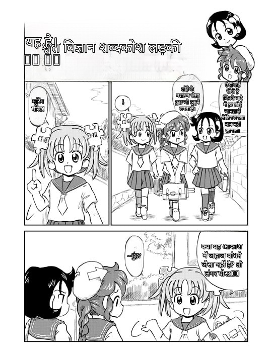
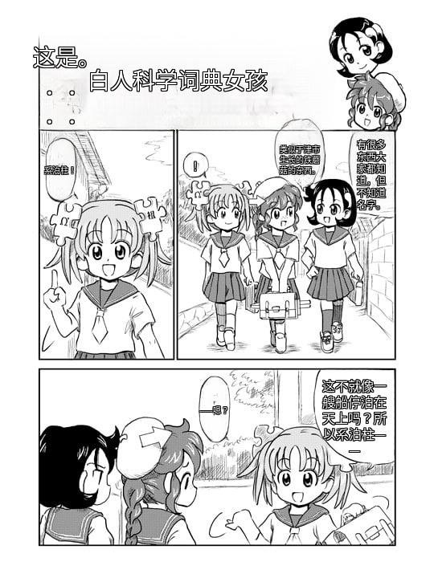

# Comic Translate 4 Free

Ngôn ngữ: [English](../README.md) · [हिन्दी](README.hi.md) · [日本語](README.ja.md) · [한국어](README.ko.md) · [简体中文](README.zh-CN.md) · [繁體中文](README.zh-TW.md) · [Español](README.es.md) · [العربية](README.ar.md) · [Français](README.fr.md) · [বাংলা](README.bn.md) · [Português](README.pt.md) · [Русский](README.ru.md) · [Tiếng Việt](README.vi.md) · [Bahasa Indonesia](README.id.md) · [اردو](README.ur.md) · [Deutsch](README.de.md) · [Română](README.ro.md)

Đọc manga bằng ngôn ngữ của bạn — ngay trong trình duyệt.

Comic Translate 4 Free tự động dịch các trang manga và truyện tranh khi bạn duyệt web. Nó đọc tiếng Nhật, tiếng Anh, tiếng Trung giản thể và phồn thể (tự động phát hiện), và dịch sang 114 ngôn ngữ. Mở một trang, và bản dịch sẽ thay thế hình ảnh gốc ngay tại chỗ — các bong bóng thoại được lấp đầy bằng ngôn ngữ của bạn.

### 📸 Trước & Sau

| Trước (tiếng Nhật) | Sau (Tiếng Việt) |
| --- | --- |
|  |  |

Xem bản dịch bằng 14 ngôn ngữ khác

| Hindi | Korean | Simplified Chinese |
| --- | --- | --- |
|  |  |  |

| Traditional Chinese | Spanish | Arabic |
| --- | --- | --- |
|  |  |  |

| French | Bengali | Portuguese |
| --- | --- | --- |
|  |  |  |

| Russian | Vietnamese | Indonesian |
| --- | --- | --- |
|  |  |  |

| Urdu | German |
| --- | --- |
|  |  |

*Minh họa Wikipe-tan gốc của Kasuga, từ [bài viết Manga trên Wikipedia](https://en.wikipedia.org/wiki/Manga) qua Wikimedia Commons — được cấp phép theo [CC BY-SA 3.0](https://creativecommons.org/licenses/by-sa/3.0/). Các ảnh chụp màn hình đã dịch là tác phẩm phái sinh đã chỉnh sửa từ bản gốc.*

---

## ✨ Tính năng

- Dịch tự động (Pro) — mở một trang manga trên một trang web được phép và bản dịch sẽ xuất hiện ngay tại chỗ, không cần bấm nút. Miễn phí 50 hình ảnh mỗi ngày; không giới hạn với Pro.
- Mỗi hình ảnh trên trang — dịch tự động xử lý tất cả hình ảnh trên một trang (tối đa 50 hình mỗi lần chạy), không chỉ hình ảnh chính.
- Dịch trước trang tiếp theo (Pro) — trong khi bạn đọc trang hiện tại, hình ảnh của trang tiếp theo được dịch trong nền nên đã sẵn sàng ngay khi bạn mở nó (chỉ một hình; bật theo mặc định, tắt được trong Cài đặt). Miễn phí 50 hình ảnh mỗi ngày; không giới hạn với Pro.
- Chuyển đổi dự phòng công cụ dịch — nếu công cụ dịch đã chọn gặp lỗi, hoặc trả về văn bản sai ngôn ngữ, tiện ích mở rộng sẽ tự động thử một công cụ khác. Miễn phí, luôn bật.
- OCR (thử nghiệm) — một công cụ OCR thử nghiệm nhanh cho các trang tiếng Nhật. Bật nó trong Cài đặt, mục Debug. Nhanh hơn nhiều trên điện thoại.
- Một tab tại một thời điểm — trong khi một tab đang dịch, nút Translate của tab còn lại bị mờ đi. Nút Cancel hiển thị "Cancel other tab".
- Nhấp chuột phải vào bất kỳ hình ảnh nào — chọn "Gửi đến Comic Translate 4 Free" để dịch một hình ảnh cụ thể, ngay cả khi nó nhỏ hơn kích thước tối thiểu.
- 114 ngôn ngữ đích qua Google Translator, Gemini, Azure Translator, hoặc máy chủ LM Studio cục bộ của riêng bạn.
- Tự động phát hiện ngôn ngữ nguồn — tiếng Nhật, tiếng Anh, tiếng Trung giản thể/phồn thể được xác định tự động từ văn bản đã OCR.
- Hỗ trợ truyện dài / webtoon — các trang cao được xử lý thành các đoạn chồng lên nhau để chữ vẫn sắc nét.
- 17 ngôn ngữ giao diện — giao diện của tiện ích mở rộng tuân theo cài đặt ngôn ngữ của trình duyệt của bạn.
- Ngôn ngữ đích mặc định là ngôn ngữ trình duyệt của bạn — thay đổi bất cứ lúc nào trong Cài đặt.

### 🔒 Quyền riêng tư

- AI chạy trên máy của bạn. Phát hiện bong bóng, OCR và inpainting đều chạy cục bộ trong trình duyệt của bạn. Phát hiện và OCR chạy qua WebAssembly. Inpainting chạy trên GPU trên Chrome (với WebAssembly dự phòng), và qua WebAssembly trên Firefox. Trang của bạn không bao giờ rời khỏi thiết bị của bạn.
- Chỉ văn bản đã dịch được gửi ra ngoài — chỉ các chuỗi đã trích xuất mới đến dịch vụ dịch thuật bạn chọn (Google / Gemini / Azure / LM Studio cục bộ của bạn).
- Không tài khoản, không theo dõi, không đo từ xa. Mọi cài đặt và mô hình đã lưu trong bộ nhớ đệm đều ở trong bộ nhớ cục bộ của trình duyệt của bạn.

---

## 🚀 Cài đặt

Chrome / Edge / Brave:

[Cài đặt từ Chrome Web Store](https://chromewebstore.google.com/detail/pndooikgcenncdohfggodonniihplppj) — một cú nhấp chuột, cập nhật tự động.

Firefox:

[Cài đặt từ Firefox Add-ons](https://addons.mozilla.org/en-US/firefox/addon/comic-translate-4-free/) — một cú nhấp chuột, cập nhật tự động.

Sau khi cài đặt, các mô hình sẽ tự động tải xuống ở chế độ nền (~350 MB: trình phát hiện, OCR, inpainter). Chúng được lưu trong bộ nhớ đệm của trình duyệt và được xác minh theo kích thước byte. Nếu bản dịch bắt đầu trước khi các mô hình tải xong, bản dịch sẽ đợi chúng.

---

## 💡 Cách sử dụng

1. Cho phép trang web trước — nhấp vào biểu tượng tiện ích mở rộng và nhấn Cho phép trang này (hoặc bật Cho phép mọi trang web). Dịch chỉ chạy ở nơi bạn đã cấp quyền.

   

2. Tải lại trang manga — nó bắt đầu dịch tự động khi trang tải. Một viên thuốc ở góc trên bên phải hiển thị tiến trình trực tiếp (Capturing → Detecting → OCR → …).
3. Xong — các hình ảnh của trang được thay thế ngay tại chỗ bằng bản dịch.

Mẹo:
- Nhấp chuột phải vào bất kỳ hình ảnh nào → Gửi đến Comic Translate 4 Free để chỉ dịch hình ảnh đó.

  

- Nếu một trang web chặn tải xuống (HTTP 403), tiện ích mở rộng sẽ tự động thử lại qua một tab nền.
- Chọn công cụ dịch của bạn trong Cài đặt: Google Translator (không cần khóa), Gemini (cần khóa, được khuyến nghị — dịch manga tốt hơn), Azure Translator (sắp ngừng hoạt động), hoặc LM Studio (máy chủ cục bộ).

---

## 🔑 Lấy khóa API Gemini

Gemini cung cấp những bản dịch manga tốt nhất. Để sử dụng nó làm công cụ dịch:

1. Mở [Google AI Studio](https://aistudio.google.com/apikey) và nhấp vào "Create API key"
2. Chọn hoặc tạo dự án Google Cloud nếu được yêu cầu
3. Sao chép khóa
4. Dán nó vào trường Khóa API Gemini trong Cài đặt của tiện ích mở rộng, sau đó nhấp vào "Kiểm tra kết nối Gemini"
5. Chọn Gemini làm công cụ dịch trong Cài đặt.

---

## 💎 Pro

Bản dịch được tính vào 50 hình ảnh miễn phí mỗi ngày khi bất kỳ tính năng Pro nào đang bật. Một hình ảnh được tính là một, dù cao bao nhiêu. Tắt cả hai tính năng Pro thì dịch miễn phí và không giới hạn. Dịch tự động và dịch trước là các tính năng Pro — miễn phí 50 hình ảnh mỗi ngày, không giới hạn với gói đăng ký Pro.

- $3/tháng hoặc $30/năm
- Mua khóa bản quyền, dán nó vào trường License key trong Cài đặt của tiện ích mở rộng, rồi nhấp vào Activate Pro. Khóa dùng được trên 2 trình duyệt.
- Khi bạn chạm mức giới hạn miễn phí 50 hình ảnh, một cửa sổ bật lên sẽ nhắc bạn một lần mỗi ngày. Sau khi bạn đánh giá tiện ích mở rộng, Get Pro sẽ thành "Copy Discount Code: 5STARS" — chạm vào đó để sao chép mã và mở trang thanh toán.

---

## ⚠️ Vấn đề đã biết

- Chưa có OCR tiếng Hàn — ngôn ngữ nguồn là tiếng Nhật, tiếng Anh và tiếng Trung giản thể/phồn thể. (Tiếng Hàn vẫn có sẵn dưới dạng ngôn ngữ đích của bản dịch.)
- Phiên lớn — dịch hàng chục hình ảnh trong một phiên có thể khởi động lại tiện ích mở rộng ở chế độ nền. Nếu điều đó xảy ra, quá trình chạy sẽ tự động tiếp tục từ chỗ đã dừng lại.
- Firefox — các mô hình chạy trong trang nền (không có tài liệu offscreen), chia sẻ bộ nhớ với mọi thứ khác. Khởi động lại trình duyệt nếu bạn thấy "no available backend found".
- Firefox chậm hơn Chrome — các tiện ích mở rộng của Firefox không thể dùng bộ nhớ dùng chung cho đa luồng (SharedArrayBuffer), vì vậy mô hình chạy trên một luồng CPU duy nhất. Đây là giới hạn của nền tảng Firefox, không phải lỗi của tiện ích mở rộng. ([Lỗi Mozilla 1673477](https://bugzilla.mozilla.org/show_bug.cgi?id=1673477)).
- Google Translator sử dụng endpoint miễn phí không chính thức và có thể bị giới hạn tốc độ.

---

## 📄 Thông báo của bên thứ ba

Dự án này lấy cảm hứng từ [ogkalu2/comic-translate](https://github.com/ogkalu2/comic-translate) — trình phát hiện bong bóng/văn bản và trình inpainting LaMa được huấn luyện trên manga là các bản xuất ONNX của nó, và logic suy luận được chuyển từ đó. (OCR sử dụng [Baberu](https://huggingface.co/genshiai-daichi/baberu-ocr) của genshiai-daichi.)

Các thư viện đi kèm, mã đã chuyển và các mô hình tải xuống trong thời gian chạy được liệt kê cùng với giấy phép của chúng trong [THIRD-PARTY-NOTICES.md](../THIRD-PARTY-NOTICES.md).

PolyForm Noncommercial License 1.0.0 — xem [LICENSE](../LICENSE).
